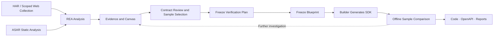

<div align="center">

<a href="docs/assets/rea-workbench-promo-30s.mp4">
  
</a>

# REA Workbench

**Turn scattered software clues into traceable engineering knowledge.**

Local software archaeology. Evidence first.

[](https://github.com/NIU-123370/rea-workbench/actions/workflows/ci.yml)  [](https://github.com/morluto/rea/tree/98d8470d36cfbf7cd25820a4ed430aebae20c0c5) [](LICENSE)

[30-second video](#video) · [Current status](#status) · [Workflow](#workflow) · [Development](#development) · [Roadmap](#roadmap) · [简体中文](README.md)

</div>

REA Workbench is a **local, single-user, evidence-driven software archaeology workbench** built on [REA](https://github.com/morluto/rea). It is designed for engineers taking over legacy systems, investigating Electron applications, or documenting HTTP interfaces, with the goal of connecting collection, analysis, contract review, and SDK verification in one traceable workflow.

> **Status: V0.1 — early development.** Domain models, data contracts, storage, REA integration, a local API, and a three-pane Web shell have foundation implementations. The worker, API, and Next.js processes can run locally and pair in a browser to read the graph. A real-provider end-to-end flow, isolated building, and full SDK delivery acceptance are not complete.

<a id="video"></a>

## REA Workbench in 30 seconds

<div align="center">

[▶ Play the 30-second promo](docs/assets/rea-workbench-promo-30s.mp4) · 1920 × 1080 · silent

</div>

> The promo explains the product direction and intended workflow. It is not a live UI recording or proof that every depicted capability has passed end-to-end acceptance. Use the status table and repository code as the source of truth.

<a id="status"></a>

## What works today

| Foundation implemented | Not complete or verified |
| --- | --- |
| Domain models, data contracts, SQLite / artifact storage, audit, and task rules | A full end-to-end workflow with a real REA provider |
| Worker, local API, Next.js three-pane shell, and browser pairing / graph readback | The ASAR static branch and scoped Web collection |
| HAR import flow, candidate-file reads, blueprint freezing, and SDK / OpenAPI generation code | Broker / sandbox processes and isolated-build gates |
| Sample comparison, export, and release-gate code | Product-level acceptance of a complete SDK delivery |

“Foundation implemented” means the module or path exists; it does not mean every platform, real provider, or release gate has been verified. See the detailed [roadmap and implementation status](#roadmap).

<a id="highlights"></a>

## From finding clues to delivering something useful

When software arrives without adequate documentation, the clues tend to be scattered across code fragments, network captures, and personal notes. The hard part is knowing which conclusions have support, which remain uncertain, and whether the evidence is sufficient for the next implementation step.

REA Workbench is designed around three questions:

| Your question | Design goal |
| --- | --- |
| What supports this claim about an interface or module? | Trace a claim back to its original Evidence, provenance, target identity, and applicable scope. |
| What was observed, and what was inferred? | Preserve `observed`, `derived`, `inferred`, and unknown states, making missing evidence explicit. |
| What did the generated code actually pass? | Review the contract and independent expected samples, define the scope, freeze the verification plan, then freeze the blueprint before comparing request construction and response parsing against fixed samples. |

### A canvas that preserves how you reached a conclusion

Bring modules, HTTP endpoints, IPC, and supporting evidence into one graph. Each claim and relationship keeps its own source and status. Gaps can become focused investigation tasks, while review records capture handoff decisions without changing what the original evidence proves.

### Clear boundaries between investigation and implementation

The product design separates two roles: **Inspector** investigates a target within its authorized scope; **Builder** receives only a reviewed, frozen blueprint. Separate contexts and permissions make the handoff inspectable and the generated result traceable to its supporting facts.

### Deliver code with its verification scope

The first release aims to produce a **TypeScript HTTP SDK, OpenAPI 3.1.1, behavior contracts, and per-sample differential reports**. Reports retain passes, failures, blocked checks, skips, and uncovered scope, alongside the targets and comparison rules used.

These are product goals. See the [roadmap](#roadmap) for what exists today.

<a id="workflow"></a>

## A workflow that starts with evidence

The following workflow is planned for V0.1:



For example, to build a client for an undocumented HTTP service:

1. Import an authorized HAR, retaining requests, responses, missing information, and source locations.
2. Inspect the evidence behind each interface, confirm observed behavior, and investigate any gaps.
3. Review the contract and independent expected samples; define the delivery scope, freeze the verification plan, then freeze the blueprint.
4. Have Builder generate an SDK, then verify it against both public samples and held-out samples withheld from Builder.
5. Export the code and reports so users can see what supports the result and which samples it passed.

ASAR follows a static analysis branch to locate modules, preload scripts, IPC, and candidate endpoints. Static facts require corresponding dynamic evidence before they can support runtime contracts. Differential results cover only request construction and response parsing under the specified samples and comparison rules.

<a id="preview"></a>

## Product direction preview


*AI-assisted interface concept illustrating the planned information layout. The repository now has a locally runnable three-pane shell, but it is not a recreation of this image; the collection panel, visual preview, and complete code-editing experience remain product direction.*

| Sandbox & Probes | Evidence Canvas | Clean-Room Studio |
| --- | --- | --- |
| Import targets, choose collection scope, and inspect collection progress and resource state. | Explore evidence relationships, locate unknowns, review contracts, and freeze blueprints. | Inspect contracts, SDK candidates, and verification differences; export deliverables. |

<a id="development"></a>

## Start developing

Install **Node.js `24.18.0` and npm `11.16.0`** first, as pinned in [`.nvmrc`](workbench/.nvmrc) and [`package.json`](workbench/package.json). These commands install dependencies and run the foundation checks:

```sh
git clone https://github.com/NIU-123370/rea-workbench.git
cd rea-workbench/workbench

node --version
npm --version
npm ci

npm run typecheck
npm run test:unit
npm run test:integration
```

| Command (run inside `workbench/`) | Purpose |
| --- | --- |
| `npm run typecheck` | Check TypeScript types. |
| `npm run test:unit` | Test domain rules, data contracts, architecture boundaries, and related modules. |
| `npm run test:integration` | Run integration tests using the real filesystem, SQLite, and a fixture MCP server. |
| `npm run lint` | Run oxlint static checks. |
| `npm run review` | Scan repository design rules and write local review findings. |

The `workbench/` package provides `worker` (assemble the worker and print a pairing code), `web` (local API process), `ui:dev` (Next.js shell), `doctor`, `typecheck`, `test`, `lint`, `review`, `docs:check`, and `perf:t17`. There is no `dev` or `db:migrate` script: migrations run when the worker starts, and offline restore uses `db:restore` after the worker is stopped. Foundation tests require neither Docker, a local model, nor a real REA provider. Fixture MCP coverage does not establish that real-provider workflows have been verified. See [workbench/README.md](workbench/README.md) for development conventions.

<details>
<summary><strong>Want to try the underlying REA tools first?</strong></summary>

Workbench uses a pinned public REA `6.4.0` commit as its contract baseline. In a separate directory, check out that version and follow the upstream guides to use the existing analysis tools. These commands run REA itself.

```sh
git clone https://github.com/morluto/rea.git rea-source
cd rea-source
git checkout --detach 98d8470d36cfbf7cd25820a4ed430aebae20c0c5
npm ci
npm run build:cached
node scripts/rea.mjs --help
```

For offline HAR and ASAR entry points, input requirements, and limitations, see the upstream [HAR guide](https://github.com/morluto/rea/blob/98d8470d36cfbf7cd25820a4ed430aebae20c0c5/docs/web-network-captures.md) and [Electron guide](https://github.com/morluto/rea/blob/98d8470d36cfbf7cd25820a4ed430aebae20c0c5/docs/electron-observation.md).

</details>

<a id="roadmap"></a>

## Roadmap and implementation status

V0.1 is moving from foundation modules toward its first complete workflow. The table describes the current codebase. “Foundation implemented” means the modules exist; product-level acceptance still requires further verification.

| Area | Status | Scope |
| --- | --- | --- |
| Domain models and data contracts | Foundation implemented | Target identity, evidence states, sample inventory, report rules, and Zod boundary validation. |
| Storage and application rules | Foundation implemented | SQLite, artifact storage, migrations and backups, audit, redaction, and task lifecycle. |
| REA integration | Foundation implemented | MCP stdio, identity probing, Evidence response parsing, and session ledger; currently covered by fixture tests. |
| Worker and local API | Foundation implemented | Runtime composition, local RPC, browser sessions, event recovery, and the API process itself (`npm run worker` / `npm run web`). |
| Three-pane UI and target import | Foundation implemented | Evidence canvas (Next.js shell + React Flow, paired and read in a real browser), candidate-file discovery and readback in the Code tab, and the HAR import flow. The ASAR static branch and scoped Web collection are not connected. |
| Isolated building and delivery | Partially implemented | Blueprint freeze and release, SDK/OpenAPI 3.1.1 generation, comparison, export, and release-gate code exist. Broker and sandbox processes do not, so isolation gates cannot be claimed as passed locally. |

The first vertical path is **fixed HAR → persisted Evidence → canvas → blueprint → SDK → offline comparison**. A V0.1 release also requires scoped Web collection, the ASAR static branch, and isolation and recovery gates. Follow [Issues](https://github.com/NIU-123370/rea-workbench/issues) and [Pull requests](https://github.com/NIU-123370/rea-workbench/pulls) for progress.

## Technology and architecture

The implementation uses **TypeScript, Zod, Node.js built-in SQLite, Vitest, and oxlint**, with dependencies pinned by the lockfile. The Web layer uses **Next.js App Router, React 18, and React Flow**; collection and isolation are planned around Playwright, Docker, and local model services.

```text
rea-workbench/
├── docs/                      # Product requirements, architecture, decisions, acceptance, and promotional assets
└── workbench/
    ├── apps/
    │   ├── web/                 # Local API and Next.js three-pane interface
    │   └── worker/              # Single-writer worker
    ├── packages/
    │   ├── domain/            # Identity, evidence, and report semantics
    │   ├── contracts/         # Boundary data contracts
    │   ├── application/       # Task, audit, and redaction rules
    │   └── adapters/          # SQLite / artifact storage and REA MCP
    ├── tests/                 # Unit tests, integration tests, and fixtures
    └── infra/                 # Repository review tools
```

REA supplies the analysis capabilities; Workbench owns the project workflow and deliverables. The design gives a local worker sole write ownership of SQLite, with UI and API access through that worker. Evidence interpretation stays at its owning boundary.

## Design documents

| Document | Read it to… |
| --- | --- |
| [PRD](docs/PRD.md) | Understand user needs, product scope, and acceptance goals. |
| [DESIGN](docs/DESIGN.md) | Contribute to architecture, data models, permissions, and interfaces. |
| [DECISIONS](docs/DECISIONS.md) | Understand technical choices and their tradeoffs. |
| [TESTPLAN](docs/TESTPLAN.md) | Inspect the test matrix, release gates, and capabilities awaiting verification. |

These documents describe the V0.1 design. Some early “not implemented” notes predate the foundation code; use the status table above and the actual code to assess current progress.

## Scope of use

The product is designed around local data storage, local models by default, and offline verification. Active Web collection requires an explicitly selected network scope. **Linux x64 + Chromium** is the first planned validation platform; full Workbench compatibility on macOS and Windows remains unverified.

Analyze only targets you own or are authorized to investigate. Isolation and clean-room handoffs are engineering mechanisms awaiting verification, and use must still respect the target’s authorization terms. The initial verification scope is sample-level client behavior. Full application reconstruction, server-side business equivalence, and malware-lab use are outside the first release.

## Help build it

Share a real software archaeology scenario, an authorized minimal reproduction, or a documentation suggestion through an [Issue](https://github.com/NIU-123370/rea-workbench/issues/new). Small, focused PRs against existing tasks are welcome. Read the relevant design contracts, run the affected checks, and describe the scope of any real-provider verification.

If this would help your work, Star the repository and follow its development.

**Acknowledgments:** [REA](https://github.com/morluto/rea) provides the underlying analysis capabilities and Evidence contracts. Notes for the promotional images and video are available in the [asset notes](docs/assets/README.md).

**License:** This project is licensed under the [MIT License](LICENSE). Upstream dependencies retain their respective licenses.
