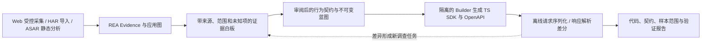

# REA Workbench

基于 REA 的本地软件考古工作台，把目标采集、证据分析、行为契约、SDK 生成与样本差分串成一个可追溯流程。前端采用三栏布局：左侧 Sandbox & Probes，中间 Evidence Canvas，右侧 Clean-Room Studio。

> 状态：V0.1 开发规格，尚未实现工作台。本文档基线是 REA `6.4.0`、公开提交 [`98d8470d36cfbf7cd25820a4ed430aebae20c0c5`](https://github.com/morluto/rea/tree/98d8470d36cfbf7cd25820a4ed430aebae20c0c5)。本目录和独立文档压缩包都只交付五份设计文档，不包含 REA 源码、工作台 `package.json`、Dockerfile、Compose 或 Web 服务。下面的 REA 命令需另行获取对应源码；工作台命令均待实现。

## 产品是什么



前向交付使用冻结快照；验证失败只能创建新调查或新版本，不能偷偷修改原始证据。REA 提供分析能力，工作台负责项目、权限、图投影、任务、蓝图和交付。

V0.1 支持 Web URL 的受控浏览器采集、HAR 1.2 离线导入，以及 `.asar` 的静态分析。Web/HAR 中可复现的 HTTP 样本可进入 SDK 闭环；孤立 ASAR 的静态事实不自动形成可验证的运行时契约。

首版交付 TypeScript HTTP SDK、OpenAPI 3.1.1、契约和验证报告。报告只说明指定样本及比较规则下，请求构造和响应解析是否吻合；不声称后端业务重构、任意 Electron 运行或全输入等价。

## 阅读顺序

| 文件                           | 内容                                   |
| ------------------------------ | -------------------------------------- |
| [PRD](docs/PRD.md)             | 用户、需求、范围、非目标、验收与里程碑 |
| [DESIGN](docs/DESIGN.md)       | 架构、所有权、表结构、字段与接口契约   |
| [DECISIONS](docs/DECISIONS.md) | 选型、原因、舍弃方案和重看条件         |
| [TESTPLAN](docs/TESTPLAN.md)   | 测试矩阵、发布门禁、升级、回滚与风险   |

## 环境与依赖

REA 基线源码开发使用固定提交的 [.nvmrc](https://github.com/morluto/rea/blob/98d8470d36cfbf7cd25820a4ed430aebae20c0c5/.nvmrc) 中的 Node.js `24.18.0` 和 [package.json](https://github.com/morluto/rea/blob/98d8470d36cfbf7cd25820a4ed430aebae20c0c5/package.json) 中的 `npm@11.16.0`。先自行准备匹配工具链，再运行命令；本方案不自动安装或升级宿主 Node、npm、Docker、Java、Ghidra 或 IDA。

工作台实现后增加以下依赖：

| 依赖                                         | 用途与约束                                                                                               |
| -------------------------------------------- | -------------------------------------------------------------------------------------------------------- |
| Docker Engine / Docker Desktop 与 Compose v2 | 自备；启动前检查实际隔离与限额能力，记录版本及镜像摘要                                                   |
| Chromium + Playwright                        | 镜像与 npm 包版本严格匹配，浏览器非 root 且启用 sandbox                                                  |
| SQLite                                       | 唯一 worker 持有数据库连接与写入队列；API 通过本机 RPC 查询及提交命令；证据大文件存在本地 artifact store |
| 本地模型服务                                 | Inspector / Builder 分离上下文；纯分析、导入和固定 fixture 测试不依赖模型                                |
| mitmproxy                                    | 首版默认不需要；HAR 与 REA 浏览器采集先跑通，后续独立 profile 接入                                       |

首个发布验证宿主限定 Linux x64 + Chromium。macOS/Windows 可运行现有 REA；工作台通过 Docker Desktop 的宿主兼容性需要另行验证，验证前不列为工作台支持平台。

Docker 隔离不构成“无菌”保证。首版只运行操作者授权的受控目标；未知恶意程序分析超出范围。隔离配置依据 [Docker 安全文档](https://docs.docker.com/engine/security/) 与 [Playwright Docker 文档](https://playwright.dev/docs/docker)，不照搬开发示例中的 root、host IPC 或关闭浏览器 sandbox 配置。

## 另行获取 REA 源码后：核对基础能力

独立解压本文档后，没有可直接运行的源码。先在自己选择的开发目录克隆公开仓库并检出与文档一致的提交；不要在文档目录中尝试执行 `npm ci`：

```sh
git clone https://github.com/morluto/rea.git rea-source
cd rea-source
git checkout --detach 98d8470d36cfbf7cd25820a4ed430aebae20c0c5
```

确认 Node.js/npm 与上述基线匹配后，从这个 **REA 源码仓库根目录**运行以下已有脚本；这些命令只验证 REA，不会启动三栏工作台：

```sh
npm ci
npm run build:cached
node scripts/rea.mjs --help
node scripts/rea.mjs mcp
```

`mcp` 是 stdio 服务，会等待客户端请求；诊断信息写 stderr，stdout 保留给 MCP。正常退出后可分别运行下面的离线分析命令，路径需换为自己的文件：

```sh
node scripts/rea.mjs inspect-web-network-capture /absolute/path/session.har har --json
node scripts/rea.mjs analyze-javascript-application /absolute/path/app.asar --json
```

HAR 检查不访问记录中的 URL，ASAR 静态分析不启动目标。更多环境和 provider 要求见同一基线的上游 [README](https://github.com/morluto/rea/blob/98d8470d36cfbf7cd25820a4ed430aebae20c0c5/README.md)、[HAR 指南](https://github.com/morluto/rea/blob/98d8470d36cfbf7cd25820a4ed430aebae20c0c5/docs/web-network-captures.md) 与 [Electron 指南](https://github.com/morluto/rea/blob/98d8470d36cfbf7cd25820a4ed430aebae20c0c5/docs/electron-observation.md)。本项目连接 REA stdio 无需运行 `rea setup` 修改用户 Agent 配置。

## 实现后如何安装和启动：约定，当前不可执行

开发时在 `workbench/` 下增加独立应用及锁文件。以下脚本必须由后续实现提交提供，不能把此处命令视为已有功能：

```sh
cd workbench
npm ci
npm run doctor
npm run db:migrate
npm run dev
```

`doctor` 检查工具链、REA 活跃会话身份、镜像摘要、浏览器 sandbox、网络封锁、存储和限额；不自动修改宿主配置。`db:migrate` 先显示计划、备份已有库，停写并取得与 worker 相同的排他锁后，由离线迁移入口应用增量迁移。`dev` 启动 Next.js 和独立 worker，浏览器入口约定为 `http://127.0.0.1:4310`，不对局域网开放。Web/API 没有 SQLite 连接或数据库文件写入权限，所有查询和变更都经本机 RPC 交给 worker。

首次启动时，服务仅在启动终端展示内存中的一次性、有过期时间的 bootstrap secret。用户在本地页面粘贴后，由页面以 `POST /api/v1/session {bootstrapToken}` 换取 `HttpOnly; SameSite=Strict` 会话 cookie，以及响应中的 `csrfToken`、`reviewerId`；令牌不会放入 URL 或日志，成功使用即失效。`reviewerId` 是本地会话标识，不代表实名认证。签发、过期、CSRF 与配置的权威契约见 [DESIGN §14](docs/DESIGN.md#14-启动与配置)。

生产运行约定为 `npm run build` 后 `npm run start`；二者也尚未实现。Docker 编排、宿主受限 broker 和镜像属于下一步代码交付，本文档不提供无法运行的 Compose 一键启动承诺。

拟定配置摘要如下；默认值、解析来源、逐项校验、启动拒绝与 `GET /health` 的 `effectiveProfiles` 均以 [DESIGN §14](docs/DESIGN.md#14-启动与配置) 为准，实现时提供 `.env.example`：

| 配置                  | 值 / 含义                                                                                                          |
| --------------------- | ------------------------------------------------------------------------------------------------------------------ |
| `WB_HOST` / `WB_PORT` | 固定 `127.0.0.1` / 默认 `4310`；拒绝其他绑定，端口按 DESIGN 校验                                                   |
| `WB_DATA_DIR`         | 用户显式选择的绝对路径，保存 SQLite、artifact 和备份；不自动清理                                                   |
| `WB_REA_ENTRYPOINT`   | 已构建 `scripts/rea.mjs` 的绝对路径；容器 profile 显式映射匹配入口，目标不可访问宿主地址；以固定 Node 参数向量启动 |
| `WB_MODEL_ENDPOINT`   | 本地模型 loopback URL；默认禁止外部模型和数据出站                                                                  |
| `WB_SANDBOX_PROFILE`  | 已安装的 profile ID；解析已验证清单中的固定镜像摘要、资源和网络规则                                                |
| `WB_BROKER_SOCKET`    | 宿主受限 Unix socket 的绝对路径；只接受固定任务及资源 ID，无任意命令或挂载参数                                     |

原始目标目录、宿主 HOME、Docker socket、Agent 配置和模型凭据均不挂入目标容器或 Builder。预览不直接 iframe 目标页面，使用单独来源的画面与受控操作通道。

## 首次使用路径：实现目标

1. 创建本地项目，导入 HAR 或填写授权 Web URL；ASAR 进入静态分析路径。
2. 选择采集范围和动作，显式开启所需网络正文；左栏展示进度、画面和采集限制。
3. 中栏按具体主张与关系展示绿、黄、红及 Evidence 来源；点击未知项创建定向调查任务。
4. 从持久 Evidence 创建并审核 vectors，独立确定库存中属于交付范围的样本，审阅行为契约并冻结其验证计划，再冻结蓝图。所需黄、红主张和计划内 blocked 样本阻断可构建交付；范围外样本及理由仍保留在库存报告。
5. Builder 在独立环境生成 SDK；离线 runner 用公开及保留样本验证，右栏显示逐项差异。
6. 导出代码、OpenAPI、蓝图摘要、样本覆盖及验证报告；未验证草稿必须带状态说明。

人工批准不会把推断改为观察；同一时间窗出现的点击和请求不会自动变成调用因果链。

## 测试命令与当前验证范围

另行获取上述固定 REA 源码后可执行的 **现有命令**，从其仓库根目录执行；独立文档包不包含这些脚本或测试：

```sh
npm run test:local -- src/domain/evidence.test.ts
npm run test:focused -- tests/boundary/mcp/webNetworkCaptureMcp.test.ts
npm run docs:check
```

工作台 **待实现命令**，从 `workbench/` 执行：

```sh
npm run typecheck
npm run test:unit
npm run test:integration
npm run test:e2e
npm run docs:check
```

本次文档交付不代表上述工作台测试、Docker 隔离、真实模型生成或端到端流程已通过。测试用例及上线要求见 [TESTPLAN](docs/TESTPLAN.md)，其中 T17 在固定宿主和 fixture 下检验 1000 条 HAR / 200 节点的 p95 ≤ 1 秒，属于首版发布门禁。

## 两周开发节奏

两周是以固定 Web fixture 跑通纵向切片的开发目标，前提是工具链和本地模型可用。第 1–2 天完成导入、REA 适配和持久 Evidence；第 3–5 天接入 P0 的 ASAR 离线静态支路、vectors、任务事件与白板；第 6–7 天完成受控 Web 录制、broker 与 Inspector；第 8–9 天完成契约/计划审阅、双 Agent 隔离、SDK/OpenAPI 和差分；第 10 天完成故障恢复、发布与 T17 性能门禁。隔离或生命周期门禁未通过就不启用目标执行，P0 ASAR 静态验收未通过也不能发布 V0.1。

完整 Electron 动态运行、mitmproxy、原生程序及 Ghidra/JAR/.NET profile 分别排期。新增 profile 仍可能要求新契约、图节点和测试，不能承诺仅换镜像即可接入。
