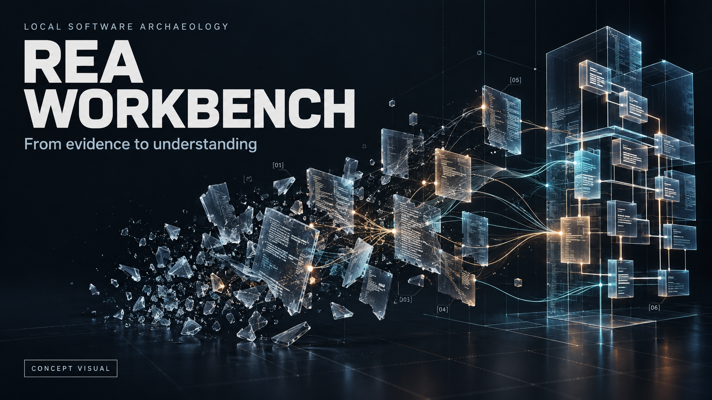
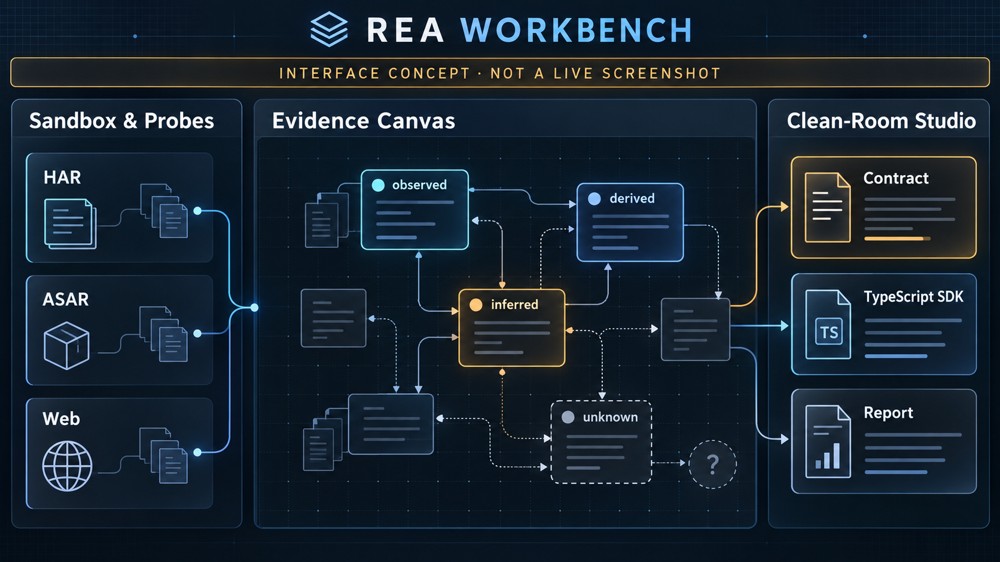
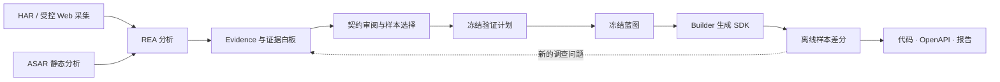

<div align="center">



# REA Workbench

**把零散的软件线索，变成可追溯的工程理解。**

Local software archaeology. Evidence first.

[](https://github.com/NIU-123370/rea-workbench/actions/workflows/ci.yml)  [](https://github.com/morluto/rea/tree/98d8470d36cfbf7cd25820a4ed430aebae20c0c5) [](LICENSE)

[项目亮点](#highlights) · [产品预览](#preview) · [开发上手](#development) · [路线图](#roadmap) · [English](README.en.md)

</div>

REA Workbench 是一个基于 [REA](https://github.com/morluto/rea) 的**本地、单人、证据驱动的软件考古工作台**。它面向接手遗留系统、理解 Electron 应用、梳理 HTTP 接口的工程师，目标是把采集、分析、契约审阅和 SDK 验证放进同一个可追溯流程。

> **当前阶段：V0.1 早期开发。** 已有领域模型、数据契约、存储、REA 适配、本机 API 与三栏 Web 外壳——三个进程（worker、API、Next）能在本机跑起来并在浏览器里配对读图。仍然没有的是真实 REA provider 端到端、隔离构建（broker/沙箱，本机无 Docker）与完整 SDK 交付验收。本文两张宣传图均为产品概念图。

<a id="highlights"></a>

## 从“看到了什么”，走到“能交付什么”

接手一个没有完整文档的软件时，线索往往散在代码切片、网络记录和个人笔记里。最难的部分，是判断哪些结论有依据、哪些仍待确认，以及这些依据是否足以支撑下一步实现。

REA Workbench 围绕这三个问题组织产品：

| 你想回答的问题 | 工作台的设计目标 |
| --- | --- |
| 这个接口或模块的行为，依据在哪里？ | 从图中的具体主张回到原始 Evidence、来源、目标身份与适用范围。 |
| 哪些是观察，哪些只是推断？ | 分别保留 `observed`、`derived`、`inferred` 与未知项，明确下一步需要补充的证据。 |
| 生成代码到底验证了什么？ | 审阅契约后，先冻结验证计划，再冻结蓝图，按固定样本比较请求构造与响应解析。 |

### 一张白板，保留理解软件的来路

把模块、HTTP endpoint、IPC 与相关证据放进同一张图。每个主张和关系都有自己的来源与状态；发现缺口时，可以从未知项发起定向调查。人工审阅记录交接决定，原始证据的证明力度始终保留。

### 让分析和构建各自拥有清楚的边界

产品设计中，**Inspector** 负责在授权范围内调查目标；**Builder** 只接收审阅后的冻结蓝图。两者使用分离的上下文与权限，交接内容可以核对，生成结果可以回查依据。

### 交付代码，也交付验证范围

首版目标产物包括 **TypeScript HTTP SDK、OpenAPI 3.1.1、行为契约与逐样本差分报告**。报告保留通过、失败、阻断、跳过及未覆盖范围；验证对象和比较规则随交付物一起留下。

这些是产品方向，当前完成情况见[路线图](#roadmap)。

<a id="preview"></a>

## 产品预览



*界面概念图，由 AI 辅助生成，用于展示计划中的信息布局；当前仓库尚无可运行的 Web UI。*

| Sandbox & Probes | Evidence Canvas | Clean-Room Studio |
| --- | --- | --- |
| 导入目标、选择采集范围、查看采集进度与资源状态。 | 浏览证据关系、定位未知项、审阅契约并冻结蓝图。 | 查看契约、SDK 候选与验证差异，导出交付物。 |

## 一条以证据为起点的工作流

以下为 V0.1 计划实现的工作流：



例如，为一个缺少文档的 HTTP 服务补齐客户端：

1. 导入有授权的 HAR，保留请求、响应、缺失信息与来源坐标。
2. 查看接口相关的证据，确认已观察到的行为，补充必要调查。
3. 审阅契约与独立预期样本，确定本次交付范围，先冻结验证计划，再冻结蓝图。
4. 由 Builder 生成 SDK，再用公开样本与未提供给 Builder 的保留样本分别验证。
5. 导出代码与报告，让使用者知道它依据什么、在哪些样本上成立。

ASAR 进入静态分析支路，用于定位模块、preload、IPC 和 endpoint 候选；其静态事实需要相应动态证据才能支持运行时契约。差分结论仅覆盖指定样本和比较规则下的请求构造、响应解析。

<a id="development"></a>

## 开发上手

当前可运行的是基础模块检查与测试。先自行准备仓库要求的 **Node.js `24.18.0` 与 npm `11.16.0`**，版本依据为 [`.nvmrc`](workbench/.nvmrc) 和 [`package.json`](workbench/package.json)。

```sh
git clone https://github.com/NIU-123370/rea-workbench.git
cd rea-workbench/workbench

node --version
npm --version
npm ci

npm run typecheck
npm run test:unit
npm run test:integration
```

| 命令（在 `workbench/` 内执行） | 用途 |
| --- | --- |
| `npm run typecheck` | 检查 TypeScript 类型。 |
| `npm run test:unit` | 运行领域规则、数据契约与架构边界等单元测试。 |
| `npm run test:integration` | 运行真实文件系统、SQLite 与 fixture MCP 服务的集成测试。 |
| `npm run lint` | 执行 oxlint 静态检查。 |
| `npm run review` | 执行仓库内的设计规则扫描，输出本地评审结果。 |

`workbench/` 下已提供 `worker`（装配 worker 并打印配对码）、`web`（本机 API 进程）、`ui:dev`（Next 页面外壳）、`doctor`、`typecheck`、`test`、`lint`、`review`、`docs:check`、`perf:t17`。`db:migrate` 与 `dev` 仍未提供：迁移由 worker 启动时执行；离线恢复入口是 `db:restore`（须先停 worker）。基础模块测试无需 Docker、本地模型或真实 REA provider；fixture MCP 测试不代表真实 provider 工作流已经验证。更多开发约定见 [workbench/README.md](workbench/README.md)。

<details>
<summary><strong>想先独立体验底层 REA？</strong></summary>

Workbench 以 REA `6.4.0` 的固定公开提交为契约基线。可以在另一个目录获取该版本，按上游指南运行已有分析工具；这些命令启动的是 REA，而非 Workbench。

```sh
git clone https://github.com/morluto/rea.git rea-source
cd rea-source
git checkout --detach 98d8470d36cfbf7cd25820a4ed430aebae20c0c5
npm ci
npm run build:cached
node scripts/rea.mjs --help
```

离线 HAR 与 ASAR 分析入口、输入要求及能力限制分别见上游 [HAR 指南](https://github.com/morluto/rea/blob/98d8470d36cfbf7cd25820a4ed430aebae20c0c5/docs/web-network-captures.md)和 [Electron 指南](https://github.com/morluto/rea/blob/98d8470d36cfbf7cd25820a4ed430aebae20c0c5/docs/electron-observation.md)。

</details>

<a id="roadmap"></a>

## 路线图与实现状态

V0.1 正在从基础模块走向第一条完整工作流。下表描述仓库当前代码范围；“已有基础实现”表示模块存在，产品级验收仍需后续验证。

| 模块 | 当前状态 | 范围 |
| --- | --- | --- |
| 领域模型与数据契约 | 已有基础实现 | 目标身份、证据状态、样本库存、报告规则与 Zod 边界校验。 |
| 存储与应用规则 | 已有基础实现 | SQLite、artifact store、迁移与备份、审计、脱敏和任务生命周期。 |
| REA 适配层 | 已有基础实现 | MCP stdio、身份探测、Evidence 响应解析与会话账本；目前以 fixture 测试覆盖。 |
| worker 与本地 API | 已有基础实现 | 运行期装配、本机 RPC、浏览器会话、事件恢复与 API 进程本体（`npm run worker` / `npm run web`）。 |
| 三栏界面与目标导入 | 已有基础实现 | 证据白板（Next.js 外壳 + React Flow 画布，已在真浏览器配对并读出图）、HAR 导入闭环；ASAR 静态支路与受控 Web 采集未接。 |
| 隔离构建与交付 | 部分实现 | 蓝图冻结与放行、SDK/OpenAPI 3.1.1 生成、差分与导出、发布门禁已有代码；broker 与沙箱进程本体未实现，隔离类门禁在本机不可声明为已通过。 |

第一条纵向开发路径是 **固定 HAR → 持久 Evidence → 白板 → 蓝图 → SDK → 离线差分**。V0.1 发布还需完成受控 Web 采集、ASAR 静态支路、隔离与恢复门禁。进展和任务见 [Issues](https://github.com/NIU-123370/rea-workbench/issues) 与 [Pull requests](https://github.com/NIU-123370/rea-workbench/pulls)。

## 技术与架构

现有实现使用 **TypeScript、Zod、Node.js 内置 SQLite、Vitest 与 oxlint**，依赖由锁文件固定。Web 层用 **Next.js App Router + React Flow**（源码编辑器要等 §8 的候选文件读取命令落地才回来，现在没有能喂给它的真数据）；采集和隔离层规划使用 Playwright、Docker 及本地模型服务。

```text
rea-workbench/
├── docs/                      # 产品需求、架构、决策、验收与宣传资产
└── workbench/
    ├── packages/
    │   ├── domain/            # 身份、证据与报告语义
    │   ├── contracts/         # 边界数据契约
    │   ├── application/       # 任务、审计与脱敏规则
    │   └── adapters/          # SQLite / artifact 存储与 REA MCP
    ├── tests/                 # 单元测试、集成测试与 fixtures
    └── infra/                 # 仓库评审工具
```

REA 提供分析能力，Workbench 负责项目工作流与交付。设计采用本地单写者持有 SQLite 的方式，让界面和 API 通过 worker 访问数据，证据解释保留在其所属边界。

## 设计文档

| 文档 | 适合什么时候读 |
| --- | --- |
| [PRD](docs/PRD.md) | 理解用户问题、产品范围和验收目标。 |
| [DESIGN](docs/DESIGN.md) | 参与架构、数据模型、权限与接口实现。 |
| [DECISIONS](docs/DECISIONS.md) | 了解技术选择及其取舍。 |
| [TESTPLAN](docs/TESTPLAN.md) | 查阅测试矩阵、发布门禁和待验证能力。 |

这些文档记录 V0.1 的设计目标，其中“未实现”的早期说明可能早于基础代码；当前完成度请结合上方状态表与实际代码阅读。

## 使用范围

产品按本地数据保存、默认本地模型和离线验证设计；主动 Web 采集需要操作者明确选择网络范围。首个计划验证平台为 **Linux x64 + Chromium**，macOS/Windows 的完整工作台兼容性尚待验证。

请仅分析你拥有或获授权的目标。隔离与洁净室交接属于待验证的工程机制，使用仍需遵守目标的授权条件。当前验证目标限于样本级客户端行为，完整应用重构、服务端业务等价及恶意程序实验室均超出首版范围。

## 一起把它做出来

欢迎通过 [Issue](https://github.com/NIU-123370/rea-workbench/issues/new) 分享真实的软件考古场景、带授权的最小复现或文档建议；也欢迎围绕已有任务提交小而明确的 PR。修改前阅读相关设计契约，运行受影响检查，并说明真实 provider 的验证范围。

如果这个方向也解决了你的问题，欢迎 Star 并关注开发进展。

**致谢**：感谢 [REA](https://github.com/morluto/rea) 提供底层分析能力与 Evidence 契约。宣传图的生成提示词见[资产说明](docs/assets/README.md)。

**许可**：本项目采用 [MIT 许可证](LICENSE)；上游依赖遵循各自许可证。
