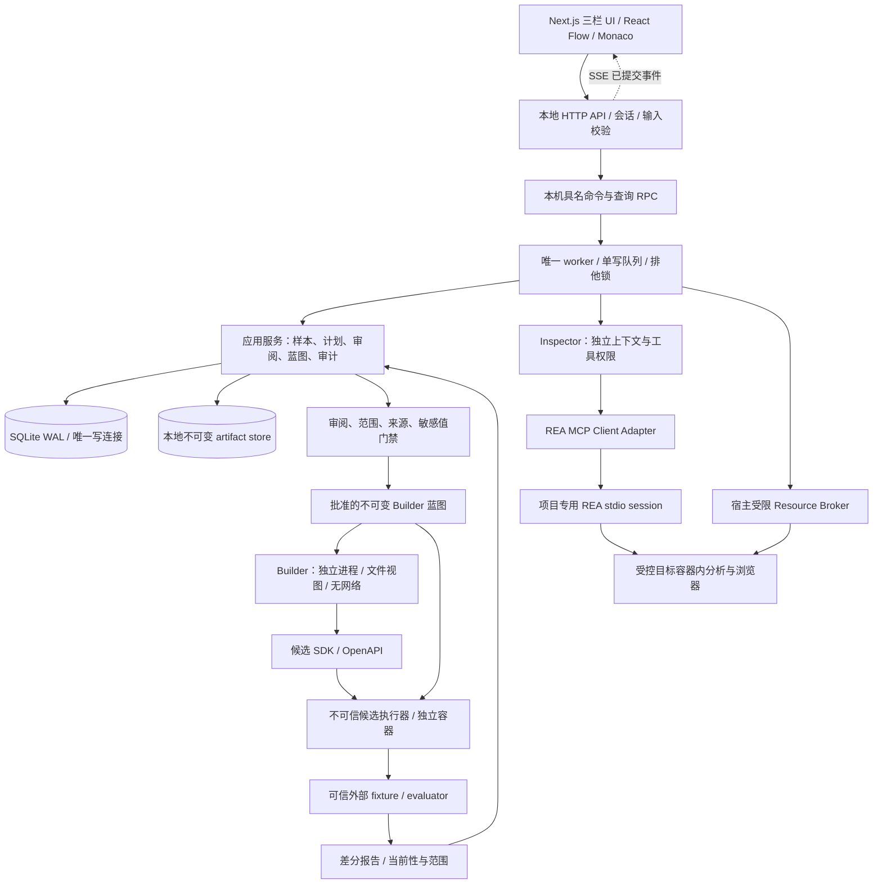
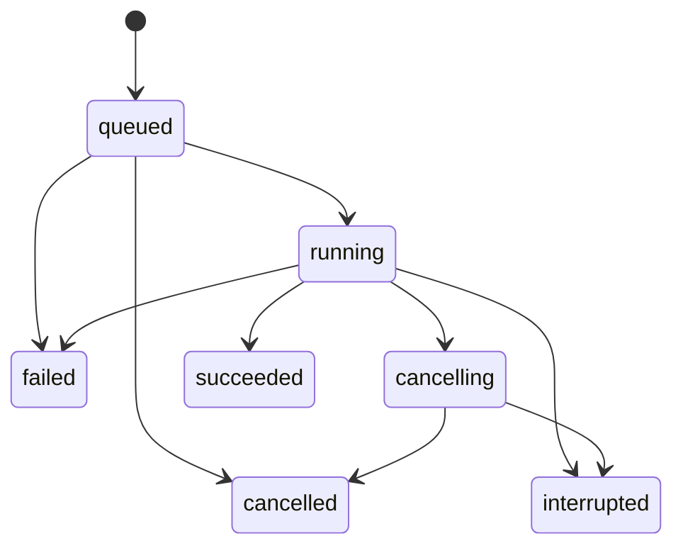

# REA Workbench 技术设计

状态：V0.1 设计契约，尚未实现。工作台是 REA 外部应用，不向 REA 注入新的 provider 语义。命令状态见 [README](../README.md)，范围与验收编号见 [PRD](PRD.md)。

## 1. 复用边界与事实来源

当前核对基线：REA `6.4.0`，提交 `98d8470`；这不是对其他版本的兼容承诺。连接时根据 `binary_session` 和 `tools/list` 验证实际身份与具名工具 schema，版本不兼容返回 `REA_CONTRACT_MISMATCH`，不按 catalog 数组位置选择操作。

| 分析问题                        | 复用的 REA 契约                                            | 工作台新增责任                                                                                                                                   |
| ------------------------------- | ---------------------------------------------------------- | ------------------------------------------------------------------------------------------------------------------------------------------------ |
| 抓包中实际记录了什么            | `inspect_web_network_capture`                              | 上传、原始输入隔离、样本资格和持久化                                                                                                             |
| 有哪些 HTTP endpoint 候选       | `inspect_analysis_view` 的 `api-surface`                   | 保留路径模板的 inferred 标记，人工限定导出范围                                                                                                   |
| ASAR 有哪些静态模块与边界       | `analyze_javascript_application`                           | 应用图投影、显示布局、未知项调查入口                                                                                                             |
| 触发 Web 动作后观察到什么       | `capture_browser_scenario`                                 | 目标授权、容器权限、网络策略、采集选择和预览                                                                                                     |
| 静态实体与运行对象可能如何对应  | `reconcile_javascript_runtime`                             | 仅接收该具名 schema 支持的 passive Web/Electron/V8、active Electron Evidence；不直接接受 `capture_browser_scenario`；保留 inferred `observed_as` |
| 某条功能路径还缺什么            | `trace_application_feature` / `trace_javascript_semantics` | Inspector 调度、问题与结果关联                                                                                                                   |
| 重构义务是否有 owner 和验证依据 | `build_reconstruction_obligation_ledger`                   | 适用时复用义务模型；新增 SDK fixture runner 和权限门禁                                                                                           |

REA 现有 `verify_reconstruction` 验证指定有限声明，`verify:readiness` 是仓库验证脚本；二者都不是现成的 HAR→SDK 生成与比较服务。

上游权威入口：[Evidence 源码](https://github.com/morluto/rea/blob/98d8470d36cfbf7cd25820a4ed430aebae20c0c5/src/domain/evidence.ts)、[应用图](https://github.com/morluto/rea/blob/98d8470d36cfbf7cd25820a4ed430aebae20c0c5/docs/javascript-application-graph.md)、[MCP 契约](https://github.com/morluto/rea/blob/98d8470d36cfbf7cd25820a4ed430aebae20c0c5/docs/mcp-contracts.md)、[HAR](https://github.com/morluto/rea/blob/98d8470d36cfbf7cd25820a4ed430aebae20c0c5/docs/web-network-captures.md)、[浏览器场景](https://github.com/morluto/rea/blob/98d8470d36cfbf7cd25820a4ed430aebae20c0c5/docs/browser-scenario-contract.md)、[重构义务](https://github.com/morluto/rea/blob/98d8470d36cfbf7cd25820a4ed430aebae20c0c5/docs/reconstruction-obligation-ledgers.md)。更新适配器时先核对这些 owner，避免二次解析同一格式。

## 2. 总体架构



物理部署中，执行目标的 REA 子进程与浏览器均在受限执行环境内；在宿主启动 REA 再由它启动浏览器并不构成容器隔离。静态 HAR/ASAR 解析同样在受限分析进程中进行。MCP adapter 通过 broker 建立的 stdio 通道通信，目标网络不能访问 UI、worker、模型服务或 broker。

无目标执行权限的 Next.js 负责页面与 API；worker 拥有全部应用命令、查询和长任务；broker 是唯一拥有容器管理权的宿主组件，仅暴露 `startProfile / inspectOwned / cancelOwned / cleanupOwned`。其输入是已解析的任务、profile 和资源 ID，不能传 shell、镜像名、任意宿主路径或 Docker 参数。目标和 Agent 不挂 Docker socket，Web 服务也不持有该 socket。

唯一 SQLite 写者是 worker 的 StorageWriter；API、broker、Agent、候选与 evaluator 均不打开数据库写连接。API 通过校验 peer identity 的私有本机 RPC 提交具名命令或查询，不传 SQL。worker 同时串行提交短命令和长任务的结果，持有数据目录的进程级排他锁；第二个 worker 无法获得锁就启动失败，不退化成多写者。离线迁移入口复用同一个 StorageWriter 实现，仅在业务 worker 停止后取得同一锁写入；只读查询与 SSE 也由 worker 提供一致快照。artifact 的正式发布同由 worker 拥有，其他进程只写分配的 staging。

逻辑数据前向流动，失败反馈创建新修订。资源调度、取消和预览是控制通道，不绕过证据与蓝图门禁。

## 3. 模块划分与依赖方向

以下为待实现源码目录，均相对 `workbench/`：

| 模块                        | 所有权                                                                       | 允许依赖                                            |
| --------------------------- | ---------------------------------------------------------------------------- | --------------------------------------------------- |
| `packages/domain`           | claim、coverage、版本与验证状态的纯语义                                      | 无 UI、数据库、REA SDK 或容器依赖                   |
| `packages/contracts`        | 严格输入输出 schema、DTO、具名接口                                           | domain；JSON Schema 2020-12                         |
| `packages/application`      | VectorService / PlanService / DiagnosticsSanitizer / AuditService 与交付流程 | domain、contracts 和抽象 ports                      |
| `packages/adapters/rea`     | MCP 身份、schema、结果解析、session、Evidence 保全                           | REA SDK 和具名源契约；向内实现 ports                |
| `packages/adapters/storage` | SQLite、artifact 写入、备份、outbox                                          | application ports                                   |
| `packages/adapters/sandbox` | broker client、profile、网络与资源边界                                       | application ports                                   |
| `packages/adapters/agents`  | 本地模型调用、独立角色上下文与工具清单                                       | application ports                                   |
| `apps/worker`               | 唯一 StorageWriter、命令/查询、恢复、leases、清理                            | application + adapters                              |
| `apps/web`                  | Next.js、React Flow、Monaco、HTTP/SSE                                        | 具名 contracts + application；不直接读原始 artifact |
| `apps/broker`               | 宿主容器监督与所有权凭据                                                     | 独立受限协议；不接受 Agent 工具调用                 |
| `infra` / `tests`           | profile、镜像清单、fixture 与验收                                            | 不成为生产业务依赖                                  |

新进程监督优先复用 REA `src/process/` 已有的身份与生命周期原则；跨包无法稳定直接复用时实现明确 adapter，不以 PID 或 executable path 冒充所有权。未来若向 REA 上游新增分析能力，遵守 [上游架构](https://github.com/morluto/rea/blob/98d8470d36cfbf7cd25820a4ed430aebae20c0c5/docs/architecture.mermaid) 的依赖方向。

## 4. 数据语义与标识

所有工作台 wire 字段使用 camelCase，REA Evidence 逐字段保留原始 snake_case；转换只发生一次。输入先从 `unknown` 进行严格 schema 解析，拒绝额外字段。内部预期失败返回 tagged `Result<T, E>`，HTTP adapter 再映射状态码。

| 类型             | 字段级约定                                                                                                                                              |
| ---------------- | ------------------------------------------------------------------------------------------------------------------------------------------------------- |
| `Id`             | 工作台生成的不透明 UUID；不是名称、地址或路径；上游 `ev_<64hex>` / `jag_*` 原样保留                                                                     |
| `Digest`         | lowercase SHA-256 64 hex；对 artifact 字节或明确版本的 canonical JSON 计算，二者不能混用                                                                |
| `Instant`        | UTC RFC 3339 字符串；展示按本地时区，记录顺序用事件序号而非时间戳                                                                                       |
| `JsonValue`      | JSON null / boolean / finite number / string / array / object；不用 `any`；不把无损数值 sidecar 转成浮点                                                |
| `Coverage`       | `{state: complete\|partial\|unknown\|unavailable, examined: integer\|null, total: integer\|null, reasons: string[]}`；complete 只指声明的集合被完整检查 |
| `Redaction`      | `{fieldPointer: string, reason: transport-auth\|explicit-sensitive, representation: omitted}`；不保留被排除值及其摘要                                   |
| `TargetSnapshot` | `{targetId, sourceKind, sourceArtifactId: Id\|null, captureArtifactId: Id\|null, snapshotDigest: Digest, scope: JsonValue}`；URL 本身不是部署内容摘要   |

文件路径、file URL、HTTP URL 分别按所属格式处理。保留用户选定 URL、路径、原始记录序号及摘要；不以 trim、通用 URL 重写或显示名作为身份解析。不得根据名字含 `token`、`secret` 推断保密性；按已知传输认证结构和操作者显式敏感声明排除值。

REA Evidence 是不可变来源。导入现存 Evidence 必须验证其 schema 和语义摘要，不修改字段后继续使用原 `evidence_id`。工作台附加的 run、权限和索引元数据存在 wrapper / 表中。应用图原有 `evidence_contexts` 和 fact 的 `context_id + location` 由 REA owner 解析，再用于投影。

## 5. SQLite 表结构

`TEXT` JSON 列先经具名 schema 校验；整数均非负，布尔以 0/1 表示。启用 foreign keys；大正文、获准保留的输入副本、代码与完整 Evidence 不塞进行或 SSE。以下为首版逻辑 schema，迁移需生成相应 DDL、CHECK、FK 与索引；这不是已存在的数据库。

| 表                   | 列与类型（`?` 可空）                                                                                                                                                                                                                                                                                                                               | 键与约束                                                                                                                                                                      |
| -------------------- | -------------------------------------------------------------------------------------------------------------------------------------------------------------------------------------------------------------------------------------------------------------------------------------------------------------------------------------------------- | ----------------------------------------------------------------------------------------------------------------------------------------------------------------------------- |
| `projects`           | `id TEXT, name TEXT, created_at TEXT, graph_revision INTEGER, inventory_revision INTEGER, schema_version INTEGER`                                                                                                                                                                                                                                  | PK id；graph 与样本库存 revision 各有 owner，不互相冒用                                                                                                                       |
| `targets`            | `id TEXT, project_id TEXT, kind TEXT(url/har/asar), original_locator TEXT?, source_sha256 TEXT?, source_artifact_id TEXT?, snapshot_digest TEXT?, identity_reason TEXT?, created_at TEXT`                                                                                                                                                          | FK project/artifact；source_artifact 是获准保留的分析产物而非已删除原始上传；源摘要与存储 artifact 摘要分离；URL 未采集前 digest=null 且有 reason；敏感 locator/digest 不落库 |
| `jobs`               | `id TEXT, project_id TEXT, target_id TEXT?, kind TEXT(capture/inspect/build/verify), state TEXT, cleanup_state TEXT, input_json TEXT, result_ref TEXT?, error_json TEXT?, idempotency_key TEXT, request_digest TEXT, deadline_at TEXT?, retry_at TEXT?, created_at TEXT, updated_at TEXT`                                                          | UNIQUE(project_id,idempotency_key)；input/error 均先过 DiagnosticsSanitizer；request_digest 不包含认证或显式敏感原文及其摘要                                                  |
| `resource_leases`    | `id TEXT, job_id TEXT, kind TEXT, resource_identity_json TEXT, ownership_proof_json TEXT, cleanup_state TEXT, last_error_json TEXT?, retry_at TEXT?, retry_count INTEGER`                                                                                                                                                                          | FK job；失败保留 ownership；last_error 仅安全诊断；重试由 CleanupService 拥有                                                                                                 |
| `artifacts`          | `id TEXT, project_id TEXT, job_id TEXT?, class TEXT, sha256 TEXT?, digest_reason TEXT?, byte_length INTEGER, storage_key TEXT, media_type TEXT, created_at TEXT`                                                                                                                                                                                   | class=`inspector/blueprint/candidate/report`；摘要排除时有 reason；storage_key 仅服务端可见，按 project+class 隔离                                                            |
| `evidence_records`   | `id TEXT, project_id TEXT, target_id TEXT, job_id TEXT, artifact_id TEXT, provider_json TEXT, operation TEXT, confidence TEXT, authority TEXT, created_at TEXT`                                                                                                                                                                                    | 复合 PK(project_id,id)，id 为 REA evidence_id；完整原样 envelope 在 artifact；索引不成为第二语义源                                                                            |
| `claims`             | `id TEXT, project_id TEXT, target_id TEXT, entity_key TEXT, claim_key TEXT, assertion TEXT, scope_json TEXT, basis TEXT, source_state TEXT?, coverage_json TEXT, validity TEXT, revision INTEGER, unknown_reasons_json TEXT`                                                                                                                       | basis=`observed/derived/inferred/unknown`；validity=`current/stale/contradicted`；UNIQUE(target_id,claim_key,revision)                                                        |
| `claim_evidence`     | `project_id TEXT, claim_id TEXT, evidence_id TEXT, location_json TEXT, role TEXT(support/contradict)`                                                                                                                                                                                                                                              | 复合 PK；复合 FK 保证同 project；不能把同一记录的反证丢弃                                                                                                                     |
| `graph_edges`        | `id TEXT, project_id TEXT, target_id TEXT, from_key TEXT, to_key TEXT, relation TEXT, claim_id TEXT`                                                                                                                                                                                                                                               | FK claim；跨目标关联必须显式建 comparison scope；不因端点存在自动证明关系                                                                                                     |
| `test_vectors`       | `id TEXT, project_id TEXT, target_id TEXT, evidence_id TEXT, source_locator_json TEXT, snapshot_digest TEXT, payload_artifact_id TEXT, digest TEXT, replaces_id TEXT?, case_key TEXT, visibility TEXT(public/holdout), eligibility TEXT(usable/blocked), reasons_json TEXT, review_status TEXT(draft/approved/rejected), review_record_json TEXT?` | 内容不可变，修订创建新 ID；VectorService 唯一生产者，创建/审阅递增 inventory_revision；Builder 不读该表                                                                       |
| `contract_revisions` | `id TEXT, project_id TEXT, target_id TEXT, contract_key TEXT, revision INTEGER, payload_json TEXT, digest TEXT, review_status TEXT(draft/approved/rejected), review_record_json TEXT?`                                                                                                                                                             | UNIQUE(project_id,contract_key,revision)；批准后正文不可改；新内容建新 revision；审批锁定 digest                                                                              |
| `verification_plans` | `id TEXT, project_id TEXT, target_id TEXT, snapshot_digest TEXT, graph_revision INTEGER, inventory_revision INTEGER, inventory_digest TEXT, payload_json TEXT, digest TEXT, review_status TEXT(draft/approved/rejected), review_record_json TEXT?, created_at TEXT`                                                                                | PlanService 从已批准契约及库存生成；selected/excluded 穷尽固定库存；审阅锁定 digest，冻结后不删计划项                                                                         |
| `blueprints`         | `id TEXT, project_id TEXT, target_id TEXT, graph_revision INTEGER, snapshot_digest TEXT, verification_plan_id TEXT, artifact_id TEXT, digest TEXT, source_manifest_artifact_id TEXT, created_at TEXT`                                                                                                                                              | FK plan；仅绑定已批准的固定计划；源码 manifest 仅控制面/evaluator 可见                                                                                                        |
| `candidates`         | `id TEXT, project_id TEXT, blueprint_id TEXT, job_id TEXT, artifact_id TEXT, digest TEXT, generator_json TEXT, dependency_manifest_json TEXT`                                                                                                                                                                                                      | FK blueprint/job/artifact；每次修复生成新 candidate                                                                                                                           |
| `verifications`      | `id TEXT, project_id TEXT, candidate_id TEXT, job_id TEXT, plan_id TEXT, plan_digest TEXT, inventory_digest TEXT, blueprint_digest TEXT, vector_set_digest TEXT, comparator_digest TEXT, runner_image_digest TEXT, result TEXT(PASS/FAIL/UNKNOWN), currentness TEXT(current/stale), summary_json TEXT, report_artifact_id TEXT`                    | 固定计划与候选身份；已发布报告不可改，失效由附加状态/审计记录表达                                                                                                             |
| `events`             | `seq INTEGER, project_id TEXT, type TEXT, aggregate_id TEXT, payload_json TEXT, created_at TEXT`                                                                                                                                                                                                                                                   | PK seq 单调递增；事务 outbox；payload 只含引用、安全摘要和状态                                                                                                                |
| `exports`            | `id TEXT, project_id TEXT, candidate_id TEXT, verification_id TEXT?, label TEXT(draft/verified-samples), artifact_id TEXT, manifest_json TEXT, created_at TEXT`                                                                                                                                                                                    | verified-samples 需要 current PASS；下载前再次核验身份；不覆盖旧包                                                                                                            |
| `audit_entries`      | `seq INTEGER, project_id TEXT?, actor_id TEXT, actor_kind TEXT, action TEXT, resource_type TEXT, resource_id TEXT?, decision TEXT(allow/deny), reason_code TEXT, safe_metadata_json TEXT, created_at TEXT`                                                                                                                                         | AuditService 追加写；未认证/启动事件 project_id=null；无原始请求、token、payload 或源码；通过 worker 统一落库                                                                 |

索引至少覆盖 jobs(project_id,state)、claims(target_id,entity_key)、claim_evidence(evidence_id)、test_vectors(project_id,target_id)、events(project_id,seq)、audit_entries(project_id,seq)。跨表的项目/目标一致性由复合 FK 和worker 内所属 application service 的事务校验共同保证；不能靠前端传来的 IDs 就接受引用。

同一 evidence_id 可出现在不同项目；数据库实际主键为 `(project_id,id)`，所有引用 Evidence 的 FK 同带 project_id。artifact 的内容去重限于同项目与同权限 class，不通过共享文件路径泄露其他 class。

文件先写项目私有 staging，流式校验、计量、fsync 后原子发布，再事务提交索引及 events。崩溃后只回收已证明属于本工作台且无引用的 staging/orphan，不能只按文件名或 PID 删除。备份使用 SQLite 一致性备份加 artifact manifest，不直接复制正在写的 `.db` 文件。

## 6. 白板 DTO 与三色投影

不再把反编译源码、生成代码和测试状态混放一个可变 `UnifiedEvidenceNode`。下列 DTO 只面向有 Inspector 权限的 UI，不提供给 Builder：

```ts
interface GraphNodeView {
  id: string; // UI 实体 ID，复用上游语义 ID 时原样保留
  kind: string; // 上游具名 kind 或明确 workbench 扩展
  label: string; // 可改名，不参与语义身份
  targetId: string;
  claimIds: string[];
  displayStatus: "SEEN" | "INFERRED" | "UNKNOWN";
  statusReasons: string[];
  evidenceIds: string[]; // 仅引用，正文另行鉴权读取
  contractRevisionIds: string[];
  coverage: Coverage;
}
interface GraphEdgeView {
  id: string;
  from: string;
  to: string;
  relation: string;
  claimId: string;
  displayStatus: "SEEN" | "INFERRED" | "UNKNOWN";
  statusReasons: string[];
}
```

`Coverage` 按第 4 节定义。节点状态仅聚合当前选定 scope 的 required claims；没有 required claims 时是 UNKNOWN。任一 required claim 过期、矛盾、缺来源、authority 不适用或覆盖不足时为 UNKNOWN；否则存在 derived/inferred 为 INFERRED；其余全为适用的 observed 才为 SEEN。strict 蓝图中的每一个 required claim/edge 必须是 SEEN；derived/inferred 的黄色与 UNKNOWN 的红色均阻断冻结，人工 approve 不能豁免。边根据自己的 claim 判定，不继承节点颜色。原始 basis/source_state 始终可查，`unavailable` 不压成“没有”。

图上的绿色不意味着实体的所有分支都已观察。静态调用边的 observed 只证明静态事实；不能用它满足“运行时已执行”的 claim。人工 review 也不改变这条规则。

## 7. 样本、行为契约与蓝图字段

### 7.1 TestVector

| 字段                                | 类型 / 必填                                    | 含义                                                                                                                                                                                                                            |
| ----------------------------------- | ---------------------------------------------- | ------------------------------------------------------------------------------------------------------------------------------------------------------------------------------------------------------------------------------- |
| `id, targetId, snapshotDigest`      | Id / Digest，必填                              | 固定来源目标和采集快照                                                                                                                                                                                                          |
| `operationId, sdkInput`             | string / JsonValue，必填                       | 对应契约中的操作和调用参数；不从预期 HTTP 请求反推 SDK 参数                                                                                                                                                                     |
| `caseKey, digest, replacesId`       | string / Digest / Id或null，必填               | caseKey 绑定契约用例要求；digest 对不可变内容计算；修订追加新向量，不覆盖原 ID                                                                                                                                                  |
| `source`                            | object，必填                                   | `{evidenceId, captureId: Id\|null, recordOrdinal: integer\|null, pointer: string\|null, transactionId: string\|null}`；HAR 不伪造 capture transaction                                                                           |
| `request.method, request.url`       | string 或 null，字段必填                       | 源值无法保留时 null，必须给 reasons/redactions 且 eligibility=blocked；usable 向量必须非 null，不补假 method/URL                                                                                                                |
| `request.query`                     | `{name:string,value:string}[]`，必填           | 有序、多值；不折叠为对象；原始 encoded URL 另存                                                                                                                                                                                 |
| `request.headers, response.headers` | `{name:string,value:string}[]`，必填           | 已脱敏；保留重复项，比较规则明确是否大小写敏感                                                                                                                                                                                  |
| `request.body, response.body`       | BodyValue，必填                                | 见下方；缺体、空体、字节与文本明确区分                                                                                                                                                                                          |
| `response.status`                   | integer 或 null，必填                          | null 表示不可用，并列出原因；不是 0→200 默认                                                                                                                                                                                    |
| `expectedOutcome`                   | object 或 null，字段必填                       | `{kind:'return',value:JsonValue}` 或 `{kind:'throw',code:string,detail:JsonValue}`；独立审阅的 SDK 解码/错误预期；null 时必须 eligibility=blocked 并有 reasons，保留在库存；如已被选入计划仍占计划总数，不复制候选输出当 oracle |
| `coverage, limitations, redactions` | Coverage / string[] / Redaction[]，必填        | 资格与信息损失                                                                                                                                                                                                                  |
| `visibility, eligibility, reasons`  | public/holdout；usable/blocked；string[]，必填 | holdout 仅控制面与 evaluator 可读，不交给 Builder；缺比较必需信息即 blocked                                                                                                                                                     |
| `review`                            | object，必填                                   | `{status:draft/approved/rejected,reviewerId:string或null,reviewedAt:Instant或null,approvedDigest:Digest或null}`；VectorService 维护，批准不升级证据                                                                             |

`BodyValue` 为严格带标签联合：`{kind:'missing', reason}`、`{kind:'empty'}`、`{kind:'text', text, provenance:'producer-decoded'}`、`{kind:'bytes', base64, sha256}`、`{kind:'redacted', reason}`。bytes 必须可验证 base64 与摘要；producer-decoded 文本不声称恢复原始 wire bytes。缺失、redacted 不能等于空。大整数、未知编码、multipart 缺边界等不能通过 JSON roundtrip 补造。

样本的唯一生产者是 `VectorService`。ingestion/capture 只提交完整 Evidence、记录坐标和图，不凭 IPC 值形状或代码片段制造 I/O。Inspector/本地操作者通过 `POST /projects/:p/vectors` 选择已持久化 Evidence 中的明确记录，并补充 operationId、caseKey、sdkInput 和独立 expectedOutcome；服务从 REA 的已解析事实提取 request/response，校验同目标/快照、表示与脱敏状态，产生 usable 或 blocked 的 draft 向量。请求不得直接上传替代的预期 HTTP request/response。`GET vectors` 与 `GET vectors/:v` 提供读取；`POST vectors/:v/review` 审阅固定 digest。Builder 没有这些端点权限，只读取蓝图中的公开投影。

### 7.2 ContractRevision

| 字段                                  | 类型 / 必填                                                                  | 含义                                                                                                                                                                |
| ------------------------------------- | ---------------------------------------------------------------------------- | ------------------------------------------------------------------------------------------------------------------------------------------------------------------- |
| `id, contractKey, revision, targetId` | Id / string / integer / Id，必填                                             | 独立身份与版本                                                                                                                                                      |
| `scope`                               | object，必填                                                                 | `{snapshotDigest, operationIds: string[], excludedBehaviors: string[]}`；主张引用只由下方 sourceClaimIds 拥有，不重复保存                                           |
| `behaviorSpec`                        | string，必填                                                                 | 只描述范围内的可观察行为，不含静态源码或原始 Inspector 解释链                                                                                                       |
| `inputSchema, outputSchema`           | JsonValue，必填                                                              | 声明 JSON Schema 2020-12 dialect；unknown 字段不强填 required/type                                                                                                  |
| `httpOperations`                      | HttpOperation[]，必填                                                        | `{operationId, method, path, requestMediaType: string\|null, responses: {status, mediaType: string\|null, schema}[]}`；method/path 保留来源，模板泛化另列待证 claim |
| `errorCases, limitations, unknowns`   | string[]，必填                                                               | 不能省略未覆盖错误与状态分支                                                                                                                                        |
| `sourceClaimIds`                      | Id[]，必填                                                                   | 主张引用的唯一所有者，必须与契约 scope 一致                                                                                                                         |
| `requiredCases`                       | `{caseKey:string,claimId:Id,kind:success/error/edge,vectorIds:Id[]}[]`，必填 | 定义该 scope 必须覆盖的用例；vectorIds 只引用已审阅向量，公开/holdout 按向量 visibility 分组派生，不重复保存两套 ID 数组                                            |
| `review`                              | object 或 null，必填                                                         | `{status, reviewerId, reviewedAt, approvedDigest}`；身份来自本地会话，批准锁定正文摘要                                                                              |
| `digest`                              | Digest，必填                                                                 | 对内容字段计算 canonical 摘要；明确排除 `digest` 自身、`review` 和可变 UI 元数据，避免 approvedDigest 自引用                                                        |

ContractService 校验每个 requiredCase.claimId 属于 sourceClaimIds，其 vectorIds 的 targetId、snapshotDigest、caseKey 匹配该契约；vector.operationId 必须同时存在于 scope.operationIds 与 httpOperations。每个声明 operation 至少有一个 requiredCase，strict 冻结时每个 requiredCase.vectorIds 非空且均已批准、usable；所需成功/错误/边界 case 必须逐项列明，不能用操作 A 的样本冒充操作 B 的覆盖。蓝图门禁重算所有 required claim 的来源和适用范围，检查 selected operations 的输入、输出及比较前置条件。不得从“一次响应含字段”推断“所有响应必含字段”，也不能让通用 JSON Schema 隐含未经证明的全输入支持。无法证明的部分保留草稿；strict 蓝图只交接明确有限的范围。

### 7.3 BuilderBlueprint：独立允许列表序列化

Builder 只能得到以下字段：`schemaVersion:1`、`blueprintId`、`blueprintDigest`、`contractRevisions:[{contractKey,revision,digest,behaviorSpec,inputSchema,outputSchema,httpOperations,errorCases,limitations,unknowns}]`、`publicVectors: PublicTestVector[]`、`generation:{language:'typescript',outputKind:'http-sdk',openapiVersion:'3.1.1'}`、`verificationScope:string[]`。

`PublicTestVector` 只含 `id`、`operationId`、`sdkInput`、脱敏后的 request/response、非 null 的 `expectedOutcome`、coverage 与 limitations；仅从 usable 向量生成，删除原始 `source`、target locator 和任何存储路径。控制面 source manifest 单独保留 `claim→Evidence→source location`、目标快照和 holdout 引用，Builder 无权读取。blueprintDigest 只对 Builder 可见 payload（不含自身摘要字段）计算；source manifest 另有摘要并由控制面绑定。

允许列表在 application handoff owner 生成并重新验证，不能通过 `{...node}`、删除几个字段或共享上下文实现。审阅还需确认 behaviorSpec/schema/example 没有夹带源码；自动检测不能保证法律结论。正文只是数据，含指令文本也不能授予工具权限。

### 7.4 样本库存与冻结验证计划

`test_vectors` 保存项目的完整历史样本库存；每个计划的库存快照仅包含其 targetId + snapshotDigest 范围内的向量版本，不混入其他目标或采集快照，也不等于某次交付承诺的测试集合。`PlanService` 在蓝图冻结前，从已批准 ContractRevision.requiredCases 的 vectorIds 联集生成 `selectedVectorIds`，绑定 inventoryRevision、inventoryDigest、graphRevision、目标快照与契约修订。每一个 selected 项都是该次计划的 required case；缺体、缺 oracle、矛盾或失效仍在集合中，不能在执行后删除、跳过或改分母获得 PASS。

`VerificationPlan` 字段为 `{id,targetId,snapshotDigest,contractRevisionIds:Id[],graphRevision,inventoryRevision,inventoryDigest,selectedVectorIds:Id[],excludedVectors:{vectorId:Id,reasonCode:outside-scope/superseded,reason:string,excludedBehavior:string,supersededBy:Id或null}[],digest,review}`。selected 与 excluded 互斥且并集覆盖固定库存快照；digest 排除自身与 review。外部提交不能任意改 selected：它必须等于契约 requiredCases 的联集。计划可作为 draft 记录 blocked 用例和缺口，供调查与负向测试；strict 蓝图只接受已批准且 required 证据与向量都满足门禁的计划。

库存中不属于当前承诺范围的样本可以在构建前审阅为 excluded，并明确未覆盖行为；与已选 scope 相关的矛盾、required 黄色/红色主张、缺少唯一必需样本不能靠排除解除。不能自动将 blocked 排除。缩小承诺必须创建新契约修订、重新审阅计划与蓝图，保留旧计划、旧报告和排除审计。

VectorService 还拥有 replacesId 修订链：只能引用同 targetId、snapshotDigest、evidenceId 及同一 source recordOrdinal/transactionId 的旧向量，禁止环和两个同时被批准的后继；不同来源记录必须新增独立 case，不能用成功记录替换失败记录；审核新版本时以 expectedInventoryRevision 做并发校验。修订补足独立 oracle/调用映射或修正明确记录的解释，观察到的 request/response 仍来自原 Evidence，不允许覆盖真实反例。新计划只引用该链当前批准的叶版本；旧版本必须继续列入库存，并在 excludedVectors 标记 `reasonCode:'superseded'` 和 `supersededBy`。其余排除使用 `reasonCode:'outside-scope'`、supersededBy=null。旧计划不能被改写；若旧版本已在 required 集合，只有创建新契约修订、新计划和新蓝图才能采用后继。superseded 不能消除源 Evidence 中与选定 scope 相关的矛盾，也不能把候选实际输出倒灌成 oracle。

报告同时列出 `counts`（冻结计划）、`inventoryCounts`（完整库存快照）及 excludedVectors。`counts.total = selectedVectorIds.length`，不得把库存总数当计划分母；`inventoryCounts.selected + excluded = total`，blocked 是重叠资格维度，不能与前三项求和。计划内 blocked 仍占 counts.total 并使结果不能 PASS。库存中被审阅排除的范围外缺体反例不污染有效主路径的计划结果，但必须继续展示排除原因与未验证范围。

发布 fixture 分成预期 PASS 的完整主路径，以及预期拒绝/UNKNOWN/FAIL 的缺体、脱敏、矛盾、过期分支。负向测试因系统正确拒绝而通过，不要求它产生 PASS 的验证报告。

## 8. API 契约

### 通用规则

全部接口前缀 `/api/v1`，JSON UTF-8，成功响应为具名对象，错误为下面的严格结构。除首次 `POST /session` 外，API 均校验有效会话或 worker 签发的受限内部 capability；所有路径参数 Id 必须匹配授权项目，角色来自服务端，不接受调用方自声明。所有带 cookie 的变更请求校验 `X-CSRF-Token` 和精确 Host/Origin；首次配对校验同源及终端一次性 token。GET 不触发目标执行，身份流程见 §14。

```ts
type ApiError = {
  error: {
    code: string;
    message: string;
    retryable: boolean;
    details: Record<string, JsonValue>;
    requestId: string;
  };
};
type JobRecord = {
  id: string;
  kind: "capture" | "inspect" | "build" | "verify";
  state:
    | "queued"
    | "running"
    | "cancelling"
    | "succeeded"
    | "failed"
    | "cancelled"
    | "interrupted";
  cleanupState: "pending" | "complete" | "failed";
  deadlineAt: string | null; // UTC RFC 3339，最晚允许开始执行的时间
  retryAt: string | null; // 队列下次启动重试；非 queued 或无计划时为 null
  cleanupRetryAt: string | null; // owned leases 的最早清理重试时间
  resultRef: string | null;
  error: ApiError["error"] | null;
};
```

`JobRecord.deadlineAt/retryAt` 分别来自 jobs.deadline_at/retry_at，由 QueueService 写入；cleanupRetryAt 由 CleanupService 根据 resource_leases.retry_at 派生。GET job、GET jobs 与 job.updated 使用相同的具名时间字段，左栏不从日志推断重试时间。终态保留原 deadlineAt 供追溯，retryAt=null；无生效期限或重试时显式 null。

本节的 `JsonValue` 按第 4 节；完整 JSON Schema 为后续实现的唯一契约源，DTO、OpenAPI 与客户端均从该源生成。创建 import/job/vector/plan/blueprint/candidate/verification/export 使用 `Idempotency-Key`；同键同安全 canonical request 返回原结果，不同非敏感 payload 返回 409。认证与显式敏感原文不进入持久 request_digest，含短期敏感上下文的请求仅在该任务仍存活时核对，重启后不得重放。依赖图版本的写入必须带 `expectedGraphRevision`。

| Method / path                                    | 请求字段（除 `?` 外必填）                                                                                                                                                                                                                                                          | 响应 / 状态                                                                                                                                                                               |
| ------------------------------------------------ | ---------------------------------------------------------------------------------------------------------------------------------------------------------------------------------------------------------------------------------------------------------------------------------- | ----------------------------------------------------------------------------------------------------------------------------------------------------------------------------------------- |
| `GET /health`                                    | 无；需本地会话                                                                                                                                                                                                                                                                     | 200 `{status:ready/degraded,schemaVersion,reaIdentity,capabilities,effectiveProfiles}`；effectiveProfiles 由 §14 BootConfig/ProfileRegistry 解析并与运行探测结果合并，不暴露凭据/宿主路径 |
| `POST /session`                                  | `{bootstrapToken:string}`；首次配对，无会话但严格校验 Host/Origin                                                                                                                                                                                                                  | 201 `{reviewerId,csrfToken,expiresAt}` 并签发 HttpOnly SameSite=Strict cookie；token 仅终端显示、内存短期保存、一次性消费；失败 401                                                       |
| `GET /session`                                   | Cookie，由浏览器附带                                                                                                                                                                                                                                                               | 200 `{reviewerId,csrfToken,expiresAt,role:local-controller}`；无有效会话返回 401                                                                                                          |
| `DELETE /session`                                | Cookie + CSRF header                                                                                                                                                                                                                                                               | 204，撤销会话并清除 cookie；重启也使全部会话失效                                                                                                                                          |
| `POST /projects`                                 | `{name:string}`                                                                                                                                                                                                                                                                    | 201 `{id,name,graphRevision:0,createdAt}`                                                                                                                                                 |
| `GET /projects`                                  | query `{cursor?:string,limit?:integer}`                                                                                                                                                                                                                                            | 200 `{items:{id,name,graphRevision,inventoryRevision}[],nextCursor:string或null}`；仅本地操作者                                                                                           |
| `GET /projects/:p`                               | 无                                                                                                                                                                                                                                                                                 | 200 `{id,name,graphRevision,inventoryRevision,targetIds:Id[],recentJobIds:Id[]}`；为重载提供受限入口                                                                                      |
| `POST /projects/:p/imports`                      | multipart：`file`、`kind:'har'\|'asar'`；`deadlineAt:Instant` 可选；HAR 可选短期 `sensitiveValues:string[]`                                                                                                                                                                        | 202 `{targetId,job:JobRecord}`；原子分配文件目标与 inspect ingestion job、owned staging lease；ASAR 携带 sensitiveValues 返回 422 `SENSITIVE_PROJECTION_UNSUPPORTED`，不伪称上游支持      |
| `POST /projects/:p/targets`                      | `{kind:'url',url:string}`                                                                                                                                                                                                                                                          | 201 `{id,kind,snapshotDigest:null,identityReason:string}`；文件目标由 imports 创建；URL 未捕获前身份未知                                                                                  |
| `GET /projects/:p/targets/:t`                    | 无                                                                                                                                                                                                                                                                                 | 200 `{id,kind,sourceSha256:Digest\|null,snapshotDigest:Digest\|null,identityReason:string\|null,evidenceIds:Id[],importJobId:Id\|null}`                                                   |
| `POST /projects/:p/jobs`                         | `{targetId,expectedGraphRevision,deadlineAt?:Instant,task:CaptureTask\|InspectTask}`，见下文                                                                                                                                                                                       | 202 JobRecord；响应头 Location 指向 job                                                                                                                                                   |
| `GET /projects/:p/jobs/:j`                       | 无                                                                                                                                                                                                                                                                                 | 200 JobRecord；含独立 cleanupState                                                                                                                                                        |
| `GET /projects/:p/jobs`                          | query `{cursor?:string,limit?:integer}`                                                                                                                                                                                                                                            | 200 `{items:JobRecord[],nextCursor:string或null}`；含持久 resultRef，可恢复构建/验证资源 ID                                                                                               |
| `POST /projects/:p/jobs/:j/cancel`               | `{}`                                                                                                                                                                                                                                                                               | 202 JobRecord；重复取消安全；完成态返回现状                                                                                                                                               |
| `POST /projects/:p/jobs/:j/cleanup-retry`        | `{}`；需幂等键与本地会话                                                                                                                                                                                                                                                           | 202 `{jobId,cleanupState,retryAt,leaseIds}`；只重新调度可证明 owned 的失败/待处理清理；不能重跑业务或改变报告；已完成返回当前状态                                                         |
| `GET /projects/:p/graph`                         | query：`afterRevision?:integer`                                                                                                                                                                                                                                                    | 200 `{revision,eventCursor,nodes:GraphNodeView[],edges:GraphEdgeView[],coverage,limitations}`；不能分页丢失连边，过大时返回具名分页快照引用                                               |
| `GET /projects/:p/evidence/:e`                   | 无                                                                                                                                                                                                                                                                                 | 200 `{evidence:ReaEvidence}` 或具名 artifact 下载引用；仅 Inspector UI；受源契约与响应字节限额约束                                                                                        |
| `POST /projects/:p/vectors`                      | `{targetId,source:{evidenceId,record:{kind:har-record,recordOrdinal:integer}或{kind:browser-transaction,transactionId:string}},operationId,caseKey,sdkInput,expectedOutcome,visibility:public/holdout,replacesId?:Id,expectedInventoryRevision:integer,sensitiveValues?:string[]}` | 201 TestVector（draft）；VectorService 从 source 提取 request/response，不接受调用方伪造这些字段；缺必要信息记录 blocked，不声称 usable                                                   |
| `GET /projects/:p/vectors`                       | query `{targetId:Id,cursor?:string,limit?:integer}`                                                                                                                                                                                                                                | 200 `{inventoryRevision,items:VectorSummary[],nextCursor:string或null}`；summary 含 id/digest/caseKey/visibility/eligibility/review；稳定快照游标，变化返回 409                           |
| `GET /projects/:p/vectors/:v`                    | 无；本地操作者/Inspector/evaluator 范围授权                                                                                                                                                                                                                                        | 200 TestVector；Builder 一律拒绝；正文按 artifact 字节限额安全读取                                                                                                                        |
| `POST /projects/:p/vectors/:v/review`            | `{decision:approve/reject,expectedDigest:Digest,expectedInventoryRevision:integer,note:string}`                                                                                                                                                                                    | 200 TestVector；审阅锁 digest，以库存 revision 防止并发批准两个后继；修改内容创建新 ID                                                                                                    |
| `POST /projects/:p/contracts`                    | `{targetId,contractKey?:string,expectedGraphRevision,scope,behaviorSpec,inputSchema,outputSchema,httpOperations,errorCases,limitations,unknowns,sourceClaimIds,requiredCases,sensitiveValues?:string[]}`                                                                           | 201 ContractRevision；引用已审阅向量；新修订创建新 ID，review=draft                                                                                                                       |
| `POST /projects/:p/contracts/:c/review`          | `{decision:'approve'\|'reject',expectedDigest:Digest,note:string}`                                                                                                                                                                                                                 | 200 ContractRevision；记录会话审阅人，不改 Evidence                                                                                                                                       |
| `GET /projects/:p/contracts/:c`                  | 无；控制面/Inspector                                                                                                                                                                                                                                                               | 200 ContractRevision；按 graph 中的修订 ID 恢复右栏内容，Builder 不可读完整控制面契约                                                                                                     |
| `POST /projects/:p/verification-plans`           | `{targetId,contractRevisionIds:Id[],expectedInventoryRevision:integer,expectedGraphRevision:integer,exclusions:{vectorId:Id,reasonCode:outside-scope/superseded,reason:string,excludedBehavior:string,supersededBy:Id或null}[]}`                                                   | 201 VerificationPlan（draft）；selected 由 requiredCases 联集派生，exclusions 必须穷尽剩余库存，不能排除 required 或矛盾证据                                                              |
| `GET /projects/:p/verification-plans/:v`         | 无；仅控制面/Inspector/evaluator                                                                                                                                                                                                                                                   | 200 VerificationPlan，包含完整 selected/excluded/缺口；Builder 不可读取                                                                                                                   |
| `POST /projects/:p/verification-plans/:v/review` | `{decision:approve/reject,expectedDigest:Digest,note:string}`                                                                                                                                                                                                                      | 200 VerificationPlan；批准锁定 scope 和全部排除理由，不能改变事实资格                                                                                                                     |
| `POST /projects/:p/blueprints`                   | `{targetId,contractRevisionIds:Id[],verificationPlanId:Id,expectedGraphRevision,sensitiveValues?:string[]}`                                                                                                                                                                        | 201 `{id,digest,verificationPlanId,planDigest,sourceManifestDigest,scope,limitations}`；required 黄/红主张、无 usable 样本或 plan 缺口返回 422 `BLUEPRINT_BLOCKED`                        |
| `GET /projects/:p/blueprints/:b`                 | 无；控制面，或受限到该 ID 的 Builder capability                                                                                                                                                                                                                                    | 200 `{id,digest,scope,bundle:BuilderBlueprint}`；控制面另获 verificationPlanId；所有角色均不经此接口读取 source manifest/holdout                                                          |
| `POST /projects/:p/candidates`                   | `{blueprintId:Id,deadlineAt?:Instant}`                                                                                                                                                                                                                                             | 202 JobRecord，成功 resultRef 为 candidate ID                                                                                                                                             |
| `GET /projects/:p/candidates/:c`                 | 无；控制面/对应生成任务                                                                                                                                                                                                                                                            | 200 `{id,blueprintId,digest,files:{id,path,byteLength,language}[]}`；file ID 来自受校验 manifest，path 仅显示                                                                             |
| `GET /projects/:p/candidates/:c/files/:f`        | 无；同上                                                                                                                                                                                                                                                                           | 200 `{fileId,content:string,sha256}`，超出正文限额提供同源鉴权下载；仅解析 manifest file ID，禁止客户端路径穿越                                                                           |
| `POST /projects/:p/verifications`                | `{candidateId:Id,comparatorPolicyId:string,deadlineAt?:Instant}`                                                                                                                                                                                                                   | 202 JobRecord；policy 必须来自已安装具名比较器，不接受代码                                                                                                                                |
| `GET /projects/:p/verifications/:v`              | 无                                                                                                                                                                                                                                                                                 | 200 VerificationReport，见第 10 节                                                                                                                                                        |
| `POST /projects/:p/exports`                      | `{candidateId:Id,verificationId?:Id,label:'draft'\|'verified-samples'}`                                                                                                                                                                                                            | 201 `{id,label,downloadUrl,sha256,manifest}`；仅相对本地下载路由，无任意输出路径                                                                                                          |
| `GET /projects/:p/exports/:e/download`           | 无；仅本地操作者                                                                                                                                                                                                                                                                   | 200 ZIP 字节；worker 校验 export 归属及 verified-samples 当前性后读取，API 不直接打开 artifact store                                                                                      |
| `GET /projects/:p/events`                        | SSE：`Last-Event-ID` 或 query `after?:integer`，不可同时冲突                                                                                                                                                                                                                       | 200 事件流；无法恢复时返回 409 `EVENT_CURSOR_EXPIRED` 并要求重读快照                                                                                                                      |
| `GET /projects/:p/audit`                         | query `{after?:integer,limit?:integer}`；仅本地操作者                                                                                                                                                                                                                              | 200 `{entries:AuditEntry[],nextCursor:integer或null}`；只读本项目安全元数据                                                                                                               |
| `GET /audit`                                     | 同上；仅本地操作者                                                                                                                                                                                                                                                                 | 200 同形对象；读取 projectId=null 的启动、会话与未认证拒绝记录；Agent 无访问权                                                                                                            |
| `GET /projects/:p/jobs/:j/preview`               | query `frame?:integer`                                                                                                                                                                                                                                                             | 200 `{frame,createdAt,imageUrl,actionState,limitations}`；仅本地受权 UI，像素图由隔离 origin 提供                                                                                         |

`CaptureTask = {kind:'capture', profileId:string, scenario:{startUrl:string, actions:BrowserAction[]}, network:{requestBody:boolean,responseBody:boolean,headerValues:boolean}, timeoutMs?:integer, sensitiveValues?:string[]}`。target 必须是 URL，scenario.startUrl 必须匹配目标授权范围；profile 中明确允许的 fixture origin 可以单独授权，不能任意换目标。

`BrowserAction` 为具名联合：`{kind:'click',locator:Locator}`、`{kind:'fill',locator:Locator,value:string}`、`{kind:'waitFor',locator:Locator,state:'visible'|'hidden'}`；`Locator` 为 `{kind:'role',role:string,name:string}` 或 `{kind:'testId',value:string}`。adapter 将这些受限动作翻译为已验证的 REA browser action 契约；不接收 JS、shell、任意 Playwright 表达式或任意文件访问。敏感输入只在当前任务内存/私有运行时存在，不进入持久 job input。

`InspectTask = {kind:'inspect',claimIds:Id[],question:string,scope:'static'|'captured-runtime'}`。HAR/ASAR 初次分析允许空 claimIds；定向调查必须列出已有主张，不可由 Agent 请求额外执行权限。主动采集需要单独 CaptureTask；问题文本不能启动任意进程。快照预览上的操作编译为新 capture 的显式动作序列，V0.1 不承诺附着任意桌面 GUI。

文件导入的 ingestion job 在 owned staging 尚存在时调用一次 REA producer，保存完整、合法且按源契约排除敏感内容的 Evidence，然后提交目标快照、图与事件，最后清理 staging。VectorService 随后通过样本创建接口从这些 Evidence 提取向量，不重新读取已删除的上传，也不跳过人工/Inspector 对调用输入和 oracle 的明确指定。后续 inspect 使用已持久化的 Evidence、具名 views 和图，不将脱敏 Evidence 当 HAR 重喂解析器；需要重新读取原始源时要求新导入。ingestion 失败时目标仍有明确失败/未知状态，不能显示为空图成功。敏感声明不持久化；进程丢失后不能带着已遗失声明静默重试原始解析，清理 staging 后由操作者重新导入。未支持所需脱敏的 REA operation 返回不可用，不能改写 envelope 并沿用原 ID。

错误码映射：400 `INVALID_INPUT`；401 `SESSION_REQUIRED`；403 `ACCESS_DENIED`；404 `NOT_FOUND`；409 `REVISION_CONFLICT / IDEMPOTENCY_CONFLICT / STALE_INPUT / EVENT_CURSOR_EXPIRED`；413 `RESOURCE_LIMIT`；422 `BLUEPRINT_BLOCKED / SAMPLE_UNUSABLE / UNSUPPORTED_FORMAT / SENSITIVE_PROJECTION_UNSUPPORTED / SENSITIVE_CONTENT_BLOCKED`；503 `CAPABILITY_UNAVAILABLE / REA_CONTRACT_MISMATCH`。异步执行的超时、取消、provider 错误和 cleanup 诊断持久化在 JobRecord，不能因轮询返回 HTTP 200 而解释为任务成功。

### SSE 事件字段

每条已提交事件：SSE `id`=`seq`，`event`=`type`，`data` 为 `{seq,projectId,type,aggregateId,createdAt,payload}`。type 为 `job.updated / evidence.committed / graph.updated / vector.created / vector.reviewed / plan.reviewed / contract.reviewed / verification.completed / resource.cleanup_failed / report.stale`。payload 只含对应资源 IDs、状态、revision 和 JobRecord 的具名截止/重试时间字段，无正文、源码、认证值或模型上下文。

事件至少一次投递；消费者按 seq 去重。图快照同时返回 eventCursor，订阅从该游标之后开始以避免读取/订阅竞态。progress 只作短期显示，不承担提交语义；没有进度百分比来源时只显示等待信息。

## 9. REA MCP 适配与 session 所有权

1. worker 为项目运行分配明确的 REA connection owner；同一 connection 的会改变 target 的操作串行执行，不共用全局 mutable session。
2. 启动后调用 `binary_session` 获取 package/catalog/provider availability，用 `tools/list` 查具名 schema。校验 SDK 转换后的 advertised schemas 及实际成功/错误 envelope；不把 docs catalog 文件当实时权威。
3. 具名成功 parser 读取 Evidence-producing reply 的 `structuredContent`；其中 `normalized_result` 和 `evidence_id` 属于 Evidence 本身。其他生命周期工具使用其各自 schema，不能假设所有返回统一 `.result`。
4. `isError:true` 时解析 content 中完整 `{error:...}`，保留 typed code、partial facts 和 cleanup 信息；不要把不存在 structuredContent 当空结果成功。
5. 大型分析可能已完成并 retained，却因传输限额不能 inline 返回。遵循 `resource_constraint` 的 evidence reference，用 `inspect_analysis_view` 或 `export_evidence_bundle` 完整保全，不盲目重跑。预算需计入 text + structured 双表示。
6. 确认完整 Evidence 已导出/提交后再关闭 target/session。retained ID 属于当前 connection 的 ledger，`close_binary` 清空该 ledger；新 connection 不会自动拥有旧记录。`get_evidence_bundle`（含 detail=summary）只读取当前 session 的保留历史。重连后可向支持 inline 输入的工具提交已持久化且校验通过的完整 Evidence；也可先调用 `import_evidence_bundle({path: absolutePath})`，把此前导出的 bundle 文件校验后原子合并进新 ledger，再引用其中的 retained ID。导入不恢复原 target、provider 进程或分析缓存。该 MCP 工具在固定基线中确实存在，见[具名契约](https://github.com/morluto/rea/blob/98d8470d36cfbf7cd25820a4ed430aebae20c0c5/src/contracts/sessionToolContracts.ts#L90-L94)与[注册实现](https://github.com/morluto/rea/blob/98d8470d36cfbf7cd25820a4ed430aebae20c0c5/src/server/registerSessionRecordTools.ts#L89-L129)；不能把裸文件路径当成已导入的 retained reference。
7. 取消先传递到 MCP/provider，等待 owned 资源监督结果；断开 Promise 不等于停止进程。错误、观察结果与 cleanupState 分开持久化。

代理通过官方结构化结果与 schema 解析，不用正则从自然语言日志“拦截出事实”。原始格式由 REA 负责解释，图/claim 只消费已经解析的事实及其来源。

## 10. SDK 差分与交付判定

V0.1 只验证 HTTP 客户端边界：给 SDK 输入 → 捕获其请求 → 与公开/保留向量的预期请求比较 → fixture 返回录制响应 → 比较 SDK 解码结果。外网关闭；fixture 在 runner 私有网络中，不访问原站。不把 HAR 直接喂给 Playwright 就当作验证 SDK 行为。

候选必须提供固定 adapter ABI：ES module 导出 `invoke(operationId: string, sdkInput: JsonValue, context: {baseUrl: string}): Promise<JsonValue>`，manifest 声明 schemaVersion、入口相对路径及具名 operation IDs；不按目录或导出顺序猜调用点。可信 harness 在不可信候选容器内加载 adapter，只向外报告 return/throw 的行为结果。expectedOutcome 来自独立审阅的契约/样本，响应解析没有 oracle 时不能 PASS。

候选执行器与可信 fixture/evaluator 分容器、文件视图和权限。候选只能获得本次 sdkInput 与正常协议响应，不能读取 holdout 文件、预期请求、expectedOutcome、比较策略内部状态或报告存储。外部 fixture 独立观测实际请求，evaluator 比较请求及 return/throw；候选 stdout 中的 PASS、伪造报告与自报请求均无权成为验证依据。候选访问原站、控制面、REA、其他容器和宿主全部拒绝；只有可信 evaluator 可以产生比较报告；它写入分配的 staging，再经具名 completion RPC 交给 worker 验证身份并提交 verifications/report artifacts。evaluator 自身没有 SQLite 或正式 artifact store 写权限。

比较器是确定性的具名版本：method、encoded path、重复 query、body bytes 默认精确；HTTP header 名大小写、JSON 语义或时间等规范化必须显式列入 policy，并产生 comparatorDigest。不能为变绿自动忽略字段、放宽 required cases 或把不稳定输出常量化。JSON 数字不能损失精度，缺失/空/null/未采集分别比较；非确定性未被显式建模时结果 UNKNOWN。

公开样本帮助生成和修复；holdout 独立留在 evaluator。后者只给 Builder 契约级类别和安全 diff，不泄露原始来源或保留样本值；未通过 holdout 可转为新一轮公开样本，但须更新向量集合摘要并重新保留独立评估样本。Builder 修复有显式次数/时间资源预算，耗尽即停止，不承诺一直自动修到全绿。

```ts
interface VerificationReport {
  id: string;
  candidateId: string;
  result: "PASS" | "FAIL" | "UNKNOWN";
  currentness: "current" | "stale";
  scope: string[];
  identities: {
    snapshotDigest: string;
    blueprintDigest: string;
    candidateDigest: string;
    vectorSetDigest: string;
    planDigest: string;
    inventoryDigest: string;
    comparatorDigest: string;
    runnerImageDigest: string;
  };
  counts: {
    total: number;
    passed: number;
    failed: number;
    blocked: number;
    skipped: number;
  };
  inventoryCounts: {
    total: number;
    selected: number;
    excluded: number;
    blocked: number;
  };
  excludedVectors: {
    vectorId: string;
    reasonCode: "outside-scope" | "superseded";
    reason: string;
    excludedBehavior: string;
    supersededBy: string | null;
  }[];
  verificationPlanId: string;
  passRate: number | null;
  cases: {
    vectorId: string;
    state: "passed" | "failed" | "blocked" | "skipped";
    reason: string | null;
    safeDiff: JsonValue | null;
  }[];
  limitations: string[];
}
```

counts 各分项之和等于冻结计划的 total；`passRate = passed / counts.total`，计划 total=0 为 null。inventoryCounts 与 excludedVectors 必须完整展示冻结库存和排除理由，不能用计划通过率冒充库存覆盖率。完整、有效、非空的全部 required cases 成功才 PASS；存在实际比较失败是 FAIL；其余是 UNKNOWN。清理失败独立记录并阻断“可交付”门禁，即使已有比较证据仍保留。未覆盖分支不因通过率被隐藏。

目标快照、契约、验证计划、所选样本集、candidate、比较器、runner 任一身份变化使相关报告 stale；新增 Evidence 与相关 claim 冲突或改变选定范围也触发失效。无关的新证据不使整个项目无条件失效。下载 verified-samples 前再次检查全部绑定，禁止用过期报告给新代码贴通过标签。

OpenAPI 生成固定为 [3.1.1](https://spec.openapis.org/oas/v3.1.1.html)，Schema Object 使用声明的兼容 dialect；工作台 REST API 的 OpenAPI 与目标 SDK 的 OpenAPI 是不同产物。前者来自服务契约源，后者来自经过审阅的行为契约，不能互相替代。

## 11. 任务、恢复与资源清理



cleanupState 是独立状态 `pending → complete|failed`，失败后可重试。只有比较结果与资源清理均满足门禁时才能交付 verified-samples；不能用 `succeeded` 覆盖 pending cleanup。队列取消不需要启动目标。暂时 broker 不可用时保留 queued 并按可见 retryAt 重试；启动前永久配置/能力失败，或达到 deadlineAt 仍未启动，则 queued→failed，保存明确错误。deadlineAt 是最晚启动时间：调用方在 job 创建接口显式提供 UTC 绝对时间时原样采用，未提供时由 QueueService 根据入队时间与 profile.limits.queueWaitMs 计算，不因重试延长。CaptureTask.timeoutMs 单独约束开始执行后的运行时长。队列 retryAt 持久化到 jobs.retry_at；清理重试只更新 lease，单独投影为 cleanupRetryAt。

CleanupService 接收 `POST jobs/:j/cleanup-retry`，在 worker 单写队列中幂等调度 lease。`failed→pending→complete/failed` 只改变清理状态，记录 retryCount/retryAt 和审计，不重新执行 capture/build/verify；无法证明 ownership 时继续保留失败/未知，不删除记录。也可由 retryAt 调度相同具名命令，UI 与自动重试共用同一个 owner。

重启时将丢失 executor 的 running/cancelling 标记 interrupted，保留已提交 Evidence，重新验证 leases 的完整所有权凭据后清理或恢复安全的读操作。目标执行不静默重放；需新幂等任务。资源已退出、容器存在与否、证明所有权、是否可编辑分别建模，不确定时留 unknown，不按 PID/path 猜测并删除。

## 12. 隔离、网络与容量

- UI、Inspector、Builder、目标及 evaluator 使用独立上下文和最小权限。Builder 仅可读 blueprint class 和自己的输出目录；原始 Evidence、原始上传、Inspector 日志/模型历史、holdout、宿主 HOME、provider 配置均不可见。
- 原始上传先进入私有短期 staging。REA 输出按认证结构和显式敏感声明排除内容后才进入持久 Evidence；显式声明只在任务内存保留。原始含认证文件不进入长期项目 artifact store；完成或失败后清除 owned staging。导入结果与来源摘要说明这是已脱敏分析副本，原文件由操作者在工作台之外保留。已知 schema 字段和 typed discriminators 保持原义，显式敏感值与固定词同名时不重命名协议。
- 目标 profile 使用非 root、只读根目录、受控 writable tmpfs、drop capabilities、no-new-privileges、启用 Chromium sandbox 和经过验证的 seccomp。禁止 privileged、host network/PID/IPC、任意宿主 mount 和 Docker socket。隔离条件不能满足则拒绝执行，不回退到 `--no-sandbox`。
- 所有网络默认拒绝。URL 采集只放行操作者选定 origin 与明确依赖；通过受限 egress 检查 DNS、重定向及最终连接地址，阻断宿主控制面、loopback、私网、link-local 和元数据地址。测试用本地 fixture 使用专用 profile 和独立网络显式例外，不能泛化为允许全部私网。
- 预览内容不得在控制面同 origin 执行；画面为像素与受控动作，禁止网页访问控制面的凭据。loopback 服务仍需 Host/Origin、HttpOnly SameSite cookie、CSRF 与 WebSocket/下载权限校验。
- profile 明确 CPU、RSS、PID、磁盘、正文展开量、执行时长和并发上限；首版单目标执行。根据真实浏览器和固定数据集测量设定初始数值，doctor/health 展示全部生效值。显式调用方 timeout 不能被隐式扩大；默认只在未提供时应用。
- 上传长度、解压展开、嵌套深度、base64、反序列化、canonical hash、双份 MCP 表示与输出 ZIP 分别预留容量；先计量再分配，不只限制 HTTP Content-Length。超额保留已完成 Evidence 和具体资源原因，不声称完整。

Docker 与浏览器 hardening 的依据见 [Docker 安全边界](https://docs.docker.com/engine/security/) 和 [Playwright 容器说明](https://playwright.dev/docs/docker)。这些是本设计选型的依据，仍须在实际宿主通过隔离测试，不构成恶意程序防护保证。

### 12.1 诊断、日志与错误的唯一过滤 owner

工作台自有输出的唯一过滤 owner 是 application `DiagnosticsSanitizer`，输入为具名诊断字段、已知传输认证结构与当前任务的显式敏感声明。各 adapter 不自行猜测秘密、拼接原文后写日志；只向 owner 交付 typed code、safe metadata 或待过滤文本。REA Evidence 的脱敏仍由上游 producer 拥有；不能过滤后篡改原 envelope 并沿用 evidence_id，无法满足声明时返回 `SENSITIVE_PROJECTION_UNSUPPORTED`。

过滤发生在任何持久化/输出之前，覆盖 `jobs.error_json`、`resource_leases.last_error_json`、audit safe_metadata、API error/message/details/requestId、SSE payload、契约正文/schema/examples、蓝图 payload（含公开样本）、broker/provider stderr、运行日志、模型/生成日志、safeDiff 与导出诊断。工作台自己产生的 requestId 为随机不透明 ID，不接受客户端原文充当 ID。明确排除的值既不保存原文，也不保存该值的 hash；不把 request body、cookie、bootstrapToken、模型上下文或环境快照作为 debug 附件。canonical 字段名和 typed discriminators 保持原义，不按 token/password 等名字进行启发式整段删除。

契约与蓝图也有强制生产门禁：ContractService 在保存正文、schema、示例前调用 DiagnosticsSanitizer 的严格 payload 检查；handoff owner 对允许列表序列化后的完整蓝图再次检查，通过后才计算 blueprintDigest 并发布。人工审阅不能替代检查。若发现需排除内容、或必要排除上下文不可用，拒绝写入或冻结并返回安全的 `SENSITIVE_CONTENT_BLOCKED`；不静默改写已批准内容后沿用原 contractDigest，也不改变 Evidence ID。修正需要新契约或向量修订并重新审阅、冻结；短期敏感声明只在所属操作的内存中保留，完成该操作全部检查后销毁。后续操作仍需排除上下文时，调用方必须重新显式提供 sensitiveValues；不能把丢失的旧声明默认为空，也不能从已脱敏载荷反推原值。向量、契约和蓝图创建接口的 sensitiveValues 仅是操作上下文，不进入主体、摘要、审批或持久 job input。

StorageWriter 与 Logger port 只接受通过具名安全 DTO 校验的输出，禁止 raw console/provider stderr 直接进入文件或终端。长文本按资源预算过滤，正文缺失或过滤上下文丢失时只记固定错误码、运行/资源 ID 与 `diagnostic_unavailable`，不猜测原文已安全。显式声明仅在 ingestion/执行的内存上下文存活；崩溃恢复和 cleanup-retry 只能使用已保存的安全诊断及结构化资源身份，不能无声明重放旧原文或重新解析上传。

### 12.2 审计落点与读取

`AuditService` 经 worker StorageWriter 向 `audit_entries` 追加记录：本地配对/撤销、权限 allow/deny、敏感组合拒绝、向量/契约/计划审阅、范围排除、蓝图冻结、清理重试和导出。`AuditEntry` 字段为 `{seq,projectId:Id或null,actorId,actorKind,action,resourceType,resourceId:Id或null,decision:allow/deny,reasonCode,safeMetadata,createdAt}`；safeMetadata 仅具名非正文事实（如 revision、case 数量、profileId），先经 DiagnosticsSanitizer，不记录原始请求、token、源码或 holdout 值。

业务变更和其审计在同一 SQLite 事务提交；审计无法写入时不执行审阅、冻结、导出或扩大权限的动作。拒绝始终生效，即使审计存储不可用：尝试写安全故障码，进入 degraded 并停止后续变更，不能反向放行。清理不会因审计磁盘故障而停止，保留 lease 并在存储恢复后补记具名故障。`GET /projects/:p/audit` 分页返回本项目记录；`GET /audit` 返回 projectId=null 的启动/会话/未认证拒绝记录。两者只向本地操作者开放，Builder、目标和候选均不可读取。

## 13. 版本、扩展与迁移

SQLite 迁移 additive、可重入；显示计划并对已有数据建立可恢复备份。profile、REA catalog identity、Blueprint schema、Comparator、OpenAPI 与 schema dialect 分别版本化。失败迁移不留下半升级库；回滚先确认旧版兼容，否则恢复相同时间点的 DB 与 artifact manifest。

V0.2 profile 统一返回 Evidence、capabilities、effects、coverage 和 cleanup，不承诺同一工具 vocabulary 能表达所有平台。Electron 动态需要兼容 runtime、完整依赖与入口；Ghidra/IDA 仍是 BYO，并保留 ephemeral/read-only、禁止保存或关闭已附着 IDA GUI 的上游约束。JAR/.NET/原生重构需要新的行为采集与比较边界，不能只换 Docker 镜像。

实现完成标准：具名 schema、DTO、迁移、API、事件、测试与文档同步；真实 provider 验证和 fixture 集成结果分别记录，未验证范围保持明确。

## 14. 启动与配置

本节是 `WB_*` 配置、ProfileRegistry 和本地会话建立的唯一设计权威；README 仅提供运行入口，配置、脚本及 profile 文件均尚未实现。

`BootConfig` 在 web/worker/broker composition root 启动时解析一次，顺序为进程显式配置覆盖已安装包的声明默认；禁止自动读取任意目标目录的 `.env`，禁止保存整个 ambient environment。所有字段从 unknown 严格解析，错误仅报告字段名和安全原因，不回显原始值。配置变更需重启并重新配对，不隐式改变在途任务的 profile。

| 配置                 | 默认 / 校验                                                                                   | 读取与使用 owner                                                                                                                           |
| -------------------- | --------------------------------------------------------------------------------------------- | ------------------------------------------------------------------------------------------------------------------------------------------ |
| `WB_HOST`            | `127.0.0.1`；首版仅接受该字面地址，拒绝 `0.0.0.0`、非 loopback、空值和拼接主机名              | WebComposition 绑定监听与精确 Host/Origin 校验；不依赖 DNS 判断本地                                                                        |
| `WB_PORT`            | `4310`；十进制整数 1–65535，冲突启动失败，不偷偷换端口                                        | WebComposition；会话同源策略使用实际端口                                                                                                   |
| `WB_DATA_DIR`        | 必填绝对目录；验证可访问性、私有权限和 worker 锁；不自动创建任意祖先或清理原目录              | WorkerComposition / StorageWriter；API 只拿 RPC，不挂该目录                                                                                |
| `WB_REA_ENTRYPOINT`  | 必填绝对路径，指向操作者另行准备的匹配 REA 包 `scripts/rea.mjs`；验证存在、包版本与摘要       | ReaAdapter / doctor 校验宿主包；执行由 broker 选择匹配 profile 内的固定 `reaContainerEntrypoint`，不能把宿主路径直接交给目标或绑定整个仓库 |
| `WB_MODEL_ENDPOINT`  | 模型生成启用时必填；只接受本地 loopback HTTP URL，无 userinfo；外部地址与隐式云 fallback 拒绝 | AgentAdapter；缺失时导入/静态分析可用、生成 capability 不可用，不伪装 ready                                                                |
| `WB_SANDBOX_PROFILE` | 必填已安装的 profile ID；只作标识查找，禁止路径穿越、未知 ID 和 caller 提供 Docker 参数       | ProfileRegistry；解析具名 schema、固定镜像摘要与限额                                                                                       |
| `WB_BROKER_SOCKET`   | 必填绝对 Unix socket；验证 socket 类型、归属与访问权限；不可是 TCP URL                        | SandboxAdapter / broker；只接受具名 start/inspect/cancel/cleanup RPC                                                                       |

ProfileRegistry 加载发行包的 `infra/profiles/*.json`（不是目标上传），每份 profile 声明 `{id,schemaVersion,reaPackageDigest,reaContainerEntrypoint,browserImageDigest,browserVersion,limits:{cpuCores,memoryBytes,pids,diskBytes,maxExpandedBytes,queueWaitMs,timeoutMs},networkPolicyId}`。缺限额、未知 dialect/版本、宿主无法落实 sandbox 或 package digest 不匹配时该 profile 不可用。registry 对 profile schema 负责，broker 只执行其已经验证的实例。资源初值须由真实 fixture 测量后随 profile 锁定，不在运行时猜测。

`doctor` 与 `GET /health.effectiveProfiles` 共同读取解析后的 BootConfig/ProfileRegistry，并加入 broker 的实际可用性、限制和安全原因；健康响应只提供 profile ID、镜像摘要、生效数字限额与 capability，不返回宿主路径、完整配置或凭据。worker 不可用、持锁失败或配置无效时 API 进入 degraded/503，不绕过 worker 自行写库。bootstrap token 是内存凭据，不属于 WB 配置、不进入 health、profile、SQLite 或备份。

首次 `dev/start` 启动时，worker 创建一次性、带 expiresAt 的随机 bootstrap token，直接交给本地启动终端显示配对码，并显示不含 token 的 `http://127.0.0.1:4310`。用户在配对页粘贴该值，由同源 `POST /api/v1/session {bootstrapToken}` 兑换。禁止把 token 放 URL、query、referrer、access log 或审计正文；token 使用后销毁，过期或 worker 重启也失效。新配对码只能由本地启动命令重新签发，Web 请求不能自行索取。

SessionService 在 worker 内存持有会话和到期时间，HTTP adapter 签发随机 opaque cookie（HttpOnly、SameSite=Strict、Path=/，HTTPS 场景另设 Secure），返回 csrfToken 与 reviewerId。后续 `GET /session` 读取当前会话，变更请求附 cookie 和 `X-CSRF-Token`；DELETE 撤销。会话不持久化，重启需重新配对。reviewerId 是本地会话的审阅标识，不声称实名身份；审阅记录保留该非凭据 ID 和锁定 digest。Inspector/evaluator 的内部 capability 由 worker 限定项目与具名操作签发，不能交换为操作者会话；Builder 只有蓝图读取和候选输出权限。
